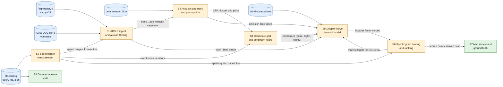

# Design document for geolocating a recording from aircraft Doppler curves

Source video: "I discovered a sound that leaks your exact location (and it's everywhere)", channel colsto, uploaded 2026-11-02, 29:12, https://www.youtube.com/watch?v=UytYrhYLOKI. Inputs: `design/00_source/source.json`, `design/02_milestones/milestones.json`, and the breakdowns in `design/03_breakdowns/M1` to `M12`.

Each fact carries the tag of its source. [shown] means visible on screen. [stated] means spoken, or written in the video description. [inferred M#-I##] is an inference made in a breakdown. [inferred D-##] is an inference this document adds. Section 8 lists every inferred item with its best guess and confidence. A time such as [00:12:11] is a video timestamp. The description says no code or tools are released [stated], so section 6 reconstructs every algorithm from the screen and the narration.

## 1. Overview

**What it is.** A geolocation investigation of a security-camera video. The picture never changes and shows only sky and trees [stated 00:00:17]. The only given facts are "In continental US" and "Filmed 9/8/26" [shown 00:00:27]. The creator's earlier thunder-based method reached about 5 km [stated 00:00:43]. This method uses aircraft Doppler curves in the audio. They are inaudible and appear only in a zoomed, high-resolution spectrogram [stated 00:01:14] [shown 00:01:45].

**What it does.** Two propeller-aircraft curves, E1 and E2, sit 920 s apart, and no aircraft is heard between them [shown 00:02:56] [stated 00:11:41]. The pipeline runs in six steps:

1. Download ADS-B tracks for every flight over the continental US on September 8 and drop known jet types [stated 00:03:04] [stated 00:04:05].
2. Fit an ideal Doppler curve to each event and record ranges for speed, CPA slant distance, CPA time, and fundamental frequency f0 [stated 00:09:12]. CPA is the closest point of approach.
3. Keep ground points that hear a flight at the E1 speed and distance, then another at the E2 speed and distance 920 ± 5 s later, and no flight between them. About 15,000 points remain across the US [stated 00:12:49].
4. For each surviving point and flight, model the exact curve the point would hear, from the aircraft velocity at the moment each sound left it [stated 00:17:01].
5. Score each model against the spectrogram. E1 gets a sweep of time offset and f0. E2 gets an f0 sweep only and keeps the time offset the flight geometry predicts [stated 00:19:28]. Survivors are rescored on a 100 m grid [stated 00:20:27].
6. Keep the best point per flight pair and rank the pairs [shown 00:21:29].

**Final result.** Flights 1100069709 and 1100048665 lead with a combined score of 20.48 at 40.876466, -73.524951. The next pair scores 15.25 [shown 00:21:39] [shown 00:21:54]. A separate search on one minute of audio with a known time of 8:37 PM UTC ranks a point 610 m away first, from a different flight [shown 00:23:31] [stated 00:24:01] [inferred M11-I02]. From a finer heat map the creator takes 40.8767282, -73.5264340 [shown 00:25:27]. Google Maps places it in Oyster Bay, New York [shown 00:25:30]. Street View at 19 Bayview Ave shows the tree line from the footage and the camera on a utility pole [shown 00:26:05]. The creator claims a result "within a couple hundred feet" from one minute of inaudible audio [stated 00:25:01]. The work took months and over 5,000 lines of code, with 50 GB Parquet files and countrywide DEMs [stated 00:02:00].

The video ends with countermeasure tests. A high-pass filter, louder masking sound, and phone-call processing all leave the curve visible. The suggested defences are cuts that break the offset between events, and extra noise cancellation [stated 00:27:06] [stated 00:28:04].

### Event names used in this document

The breakdowns label the curves differently. This document uses the labels that the creator's scoring tools print.

| Name | Tool label | Elapsed recording time | Time in the 60:00 file | Curve | Used for |
|---|---|---|---|---|---|
| E0 | "Single-Event (1:21:16)" [shown 00:23:31], QGIS layer `1:21:20_candidat...` [shown 00:02:09] | 4876 s | about 1258 to 1295 s [shown 00:01:52] | faint, about 510 to 310 Hz [shown 00:23:31] | one-minute known-time search, M11 |
| E1 | "event1 (1:35:52)" [shown 00:19:27] | 5752 s | about 2090 to 2180 s [shown 00:02:31] | louder, with harmonics, about 180 to 82 Hz, f0 about 112.5 Hz [shown 00:17:53] [shown 00:19:27] | two-event search, flight 1100069709 |
| E2 | "event2 (1:51:13)" [shown 00:19:27] | 6673 s | about 3035 to 3117 s [shown 00:02:34] | about 178 to 100 Hz, f0 about 130 to 133.5 Hz [shown 00:10:30] [shown 00:18:33] | two-event search, flight 1100048665 |

The 60:00 file is named `oyster bay_20260913T191804Z_60to120min` [shown 00:03:55]. Elapsed time minus 3600 s gives the file time of all three curves. The same offset puts E1 and E2 under the two planes of the 920 s diagram [shown 00:10:35] [inferred D-01]. Under this reading, the M1 breakdown's "event 1" is E0, its "event 2" is E1, and its "possible third curve" is E2. The narration agrees. After the louder curve and "one more here", the creator says "these two are what we'll be using" [stated 00:02:31]. The Doppler Curve Fit window 01:50:30 to 01:52:15, which M5 and M7 call event 1, contains the E2 label, so that demo is on E2 [inferred M5-I11]. Section 8 lists each conflict with both values and their sources.

## 2. System architecture

The project has eight systems. S1 to S6 form a filter-then-score pipeline. S7 is map review and ground truth. S8 is a separate set of audio experiments. The responsibilities below summarise the breakdowns. Section 6 tags each detail.



### Responsibilities

| Id | System | Responsibilities | Milestones |
|---|---|---|---|
| S1 | ADS-B ingest and aircraft filtering | Download every flight over the continental US for the day, with whole trails. Drop known jets by ICAO Engine Type. Resample tracks to 1 s. Cut tracks into velocity segments per event, and to a time window when the recording time is known. | M2, M6, M11 |
| S2 | Spectrogram measurement | Find curves with a narrow band and a long FFT window. Fit an ideal constant-velocity curve per event and record ranges for speed, CPA slant distance, CPA time, and f0. Trace a very faint curve as a line. | M1, M5, M11, M12 |
| S3 | Acoustic geometry and propagation | Compute the CPA, the 3D slant distance from ADS-B altitude and DEM ground elevation, the delayed CPA time, and the emission time for any reception time. | M3, M6, M8 |
| S4 | Candidate grid and constraint filters | Lay a 200 m grid, first within 10 km of each track, later only in each event's slant-distance band. Apply the 920 ± 5 s offset, speed, distance, and silence filters. | M3, M4, M6 |
| S5 | Doppler curve forward model | For each candidate point and flight, compute the heard frequency over time from the radial velocity at emission time. | M7, M8 |
| S6 | Spectrogram scoring and ranking | Score curves by spectrogram brightness or by distance to a traced line. Run the locked two-event sweep. Densify survivors to 100 m. Rank the best point per flight pair. | M9, M10, M11 |
| S7 | Map review and ground truth | Show layers and heat maps in QGIS. Copy the coordinate into Google Maps and match the tree line in Street View. | M10, M11 |
| S8 | Countermeasure tests | Apply high-pass filtering, masking, and phone-call processing to audio with a known curve, then look for the curve. | M12 |

### Interfaces

| From | To | Artifact | Format | Fields |
|---|---|---|---|---|
| S1 | S1 | `flight_ids_airborne` | CSV [shown 00:03:11] | `flightid`, `registration`, `typecode`, `callsign`, `first_seen_utc`, `last_seen_utc`, `max_alt`, `sample_lat`, `sample_lon` [shown 00:03:56] |
| S1 | S1 | tracks | CSV [shown 00:03:11], later Parquet of about 50 GB [stated 00:02:06] [inferred M2-I11] | `flightid`, `timestamp`, `latitude`, `longitude`, `altitude`, `ground_speed`, `track`, `vertical_speed`, `source` [shown 00:03:13] |
| S1 | S3, S4, S5 | `flight_<id>_track_1sec` | point layer [shown 00:04:26] | `fid`, `timestamp`, `utc_time`, `lat`, `lon`, `alt_ft`, `gs_kt`, `vs_fpm`, `track_deg`, `valid` [shown] |
| S1 | S4 | velocity segments, green for E1 and pink for E2 | line layers [shown 00:10:48] | flight id and time span [inferred M6-I01] |
| S2 | S1, S4, S6 | event measurement | small record | elapsed CPA time, f0, speed range, CPA distance range, 920 s gap [shown 00:10:35] |
| S2 | S6 | spectrogram matrix and traced line `LINE_POINTS` | dB array, list of (time, frequency) pairs [shown 00:23:31] [inferred M11-I10] | brightness per time-frequency bin |
| S3 | S4 | `flight_<id>_candidate_gridpoints` | point layer [shown 00:04:50] | `retarded_cpa_time`, `cpa_distance_m`, `ground_elevation_m` [shown] |
| S4 | S4 | `gridpoints_heard_multiple` | point layer [shown 00:06:58] | `fid`, `n_flights`, and comma-separated `flight_ids` and `retarded_cpa_times` [shown] |
| S4 | S5, S6 | candidates | point layers `post offset pre sil...` and `post silence + offs...` [shown 00:02:09] | grid point, E1 flight, E2 flight [inferred M4-I03] |
| S5 | S6 | model curve | NumPy arrays [shown 00:02:08] | Doppler factor per reception frame, indices of frames where the track is valid |
| S6 | S7 | scored candidates | Plotly-style HTML pages [shown 00:21:07] [inferred M10-I08] and QGIS layers under `event scores` [shown 00:25:24] | `flight1`, `flight2`, `lat`, `lon`, `score_1`, `score_2`, `match_score` [shown 00:21:39] |
| S7 | person | final coordinate | EPSG:4326 decimal degrees [shown 00:25:27] | 40.8767282, -73.5264340 |

**Three clocks.** ADS-B times are UTC epoch seconds [shown 00:04:26]. The fit and scoring tools show elapsed seconds from the start of the full recording [shown 00:17:48]. The spectrogram app shows seconds into the 60:00 file [shown 00:01:52]. Elapsed time equals file time plus 3600 s [inferred D-01]. The two-event search never needs the UTC time of the recording. It anchors each candidate's modelled delayed CPA to the measured audio time of E1 [stated 00:19:04].

## 3. Bill of materials

The search needs no hardware beyond a computer. The bill covers data, services, and the countermeasure rig.

| Item | Spec | Quantity | Source time | Tag |
|---|---|---|---|---|
| Target recording | Security-camera audio. File `oyster bay_20260913T191804Z_60to120min`, 60:00.000, channels CH 1 and CH 2, sample rate not shown. The description links the full recording, https://youtu.be/4CxVxuMVkMc. | 1 | 00:01:20, 00:03:55 | [shown], link [stated], rate [inferred M1-I05] |
| Known facts | "In continental US", "Filmed 9/8/26" | 2 | 00:00:27 | [shown] |
| ADS-B flight data | Flightradar24 trails through `pyfr24`. Every flight over the continental US on September 8, whole trails. Fields position, altitude, ground speed, track, vertical speed, timestamp, type code. | one day of all flights, a few hours to download, about 50 GB of Parquet | 00:03:04, 00:03:13, 00:02:06 | [shown], [stated] |
| Aircraft type table | ICAO DOC 8643 Aircraft Type Designators. Columns Manufacturer, Model, Type Designator, Description, Engine Type, Engine Count, WTC. Page shows "Last Updated: 01 October 2026". | 7,261 entries | 00:04:02 | [shown] |
| Digital elevation model | QGIS layer `dem_mosaic_1km`, single band, continental US. Source dataset not named. | 1 mosaic | 00:06:20 | [shown], 1 km and metres [inferred M3-I04] [inferred M3-I05] |
| Wind observations | Loaded by `fetch_or_load_wind_day(date_str)`, fields `sknt`, `drct`, `valid` | one day | 00:02:08 | [shown], source [inferred M1-I13] |
| Basemaps | Google satellite, Carto, and Bing layers in QGIS | 3 | 00:02:09 | [shown] |
| Google Maps and Street View | Street View imagery Sep 2025 at 19 Bayview Ave, Oyster Bay, New York | 1 location | 00:25:42 | [shown] |
| Computer | Python 3.14 interpreter "Planev2". Hardware not shown. | 1 | 00:02:08 | [shown] |
| Comparison clips | Two flyover clips, 0:09.079 and 1:51.061 long | 2 | 00:08:39, 00:08:43 | [shown] |
| Test audio for the high-pass test | Track "audio", about 4:50, curves at about 70 to 300 Hz | 1 | 00:26:28 | [shown] |
| JBL Bluetooth speaker | Plays a Doppler curve for the masking and phone-call tests | 1 | 00:26:54, 00:27:38 | [stated] |
| Smartphones | Two phones on a voice call, iPhone-style call UI with mute | 2 | 00:27:33, 00:27:44 | [shown] |
| Handheld microphone and laptop | Mic pointed at the receiving phone, cabled to a laptop | 1 each | 00:27:33 | [shown] |
| Squishmallows | Cover the receiving phone and mic to block leakage from the speaker | several | 00:27:38 | [shown] [stated] |

## 4. Tools and software

| Tool | Used for | System | Tag |
|---|---|---|---|
| Python 3.14, project `Planev2` | All pipeline code, over 5,000 lines | S1 to S6 | [shown 00:02:08] [stated 00:02:00] |
| NumPy | Vectorised geometry and Doppler code in `v31.py` | S3, S5 | [shown 00:02:08] |
| Polars | Exploding and normalising FR24 trails | S1 | [shown 00:03:13] |
| `asyncio`-style `async def`, `csv`, `zoneinfo` | Phase 1 sweep, CSV logs, local-to-UTC conversion | S1 | [shown 00:03:09] |
| `pyfr24` (stiles/pyfr24, v0.3.0, CC0-1.0) | Flightradar24 client | S1 | [shown 00:03:04] |
| Flightradar24 web map | Illustrates ADS-B. The paid API was mentioned and not used. | S1 | [shown 00:02:47] [stated 00:02:57] |
| Parquet | Storage for the 50 GB flight data | S1 | [stated 00:02:06] |
| QGIS | Map layers, Identify Results, Measure tool (ellipsoidal), Copy Coordinate | S3, S4, S7 | [shown 00:04:26] [shown 00:25:27] |
| Custom spectrogram app | Waveform and spectrogram "Multi-view", Selection analysis panel, Settings panel. Its status bar reads "Claude Code". | S2 | [shown 00:01:28], built with Claude Code [inferred M1-I03] |
| "Doppler Curve Fit" page | Ideal-curve sliders over a spectrogram, snapshot log | S2 | [shown 00:08:57] |
| "CPA Timeline" page | Illustrates the 920 s window check | S4 | [shown 00:07:13] |
| Interactive demos | Radial-velocity explorer, curve-shape explorer, "Building the Doppler Curve, Step by Step" | S5 | [shown 00:15:09] [shown 00:16:45] |
| Scoring viewers | "Right vs Wrong Model", locked dt overview, score scatter, "Top 7 flight-pair combos", single-event histograms and top-8 panels | S6 | [shown 00:17:48] [shown 00:21:07] [shown 00:23:22] |
| Plotly | Plot library for the pages above, judged from the toolbar | S2, S4, S6 | [inferred M10-I08] |
| PyCharm-style IDE | Editing the scripts | all | [shown 00:02:08], identity [inferred M1-I04] |
| Audacity | Frequency-boosted playback, high-pass, Amplify, MP3 export, spectral selection | S2, S8 | [shown 00:03:49] [shown 00:26:31] |
| Spreadsheet app | Viewing `flight_ids_airborne` | S1 | [shown 00:03:56] |
| Google Maps and Street View | Ground truth | S7 | [shown 00:25:30] |
| Google Earth flight sim | Illustration only | none | [shown 00:13:56] |

Scripts and files seen in the project tree [shown 00:02:08] [shown 00:03:09]:

- Pipeline: `v17.py` to `v31.py`, `v20 - best.py`, `v22 plus elev test.py`, `v23 scoring based...`, `1.1 v8 CRS fix.py`, `1.1b v2 aggregate.py`, `1.2a v9.py`, `1.2a v10.py`, `1_2b_v7.py` [shown 00:21:07].
- Data: `download flightpaths v6.py`, `download DEM.py`, `check jets in outputs.py`, `remove jets from ca...`, `save filtered flightp...`, `all flightlines to gpkg...`, `all flightpaths as gpkg...`, `flights to GPKG poi...`, `flight ID to gpkg do...`, `csv check.py`.
- Audio and tools: `spectro measurer v3.py`, `curve trace v1.py`, `audio measure temp.py`, `audio trim.py`, `event_data.py`, `event candidate polyli...`, `doppler explorer html drag point and curve.py`, `doppler_explorer.html`, `radial_velocity_explor...`, `funnel charts.py`, `3d demo.py`, `crop vid.py`.

## 5. Build plan

Build in this order. Each milestone ends in a check you can run against numbers from the video.

### M1. Find the Doppler curves in the recording

Video 00:00:17 to 00:02:37. System S2.

**Prerequisites.** The 60:00 file [shown 00:03:55] or the full recording linked in the description [stated]. A spectrogram viewer that sets the band and the FFT window.

**Steps.**

1. Open the file. It is 60:00.000 long with CH 1 and CH 2 [shown 00:01:20]. Nothing is audible, and the waveform stays within about ±0.006 of full scale [shown 00:01:20].
2. Open the spectrogram with a Hamming window, zero padding 1, a linear frequency scale, a 5 Hz minimum, and 20 dB gain [shown 00:01:42].
3. Set the maximum frequency to 800 Hz [shown 00:01:43].
4. Raise the window size from 2048 through 4096 and 8192 to 16384. The curves sharpen at each step [shown 00:01:45].
5. Find E0 near 1258 to 1295 s, falling from about 500 to 330 Hz [shown 00:01:52].
6. Find E1 near 2090 to 2180 s. It is louder, with traces near 2x and 3x its fundamental [shown 00:02:31] [stated 00:02:25].
7. Zoom out to 1600 to 3400 s and find E2 near 3035 to 3117 s [shown 00:02:34].

**Acceptance.** E0, E1, and E2 are visible at those file times, and E1 shows harmonics. Values read off axis ticks may be off by about 5 s and 20 Hz [inferred M1-I11].


### M2. Download ADS-B data and keep propeller aircraft

Video 00:02:37 to 00:04:14. System S1.

**Prerequisites.** Python with `pyfr24` v0.3.0 [shown 00:03:04] and Polars [shown 00:03:13]. Access to Flightradar24 trails [inferred M2-I04]. The ICAO DOC 8643 table [shown 00:04:02].

**Steps.**

1. Run Phase 1, the flight-ID discovery sweep. Step through timestamps across the local day of September 8 and query `BBOX_TARGET` at each. If a query returns `FLIGHT_LIMIT` flights or more, split the box into south and north halves and recurse [shown 00:03:09].
2. Drop flights whose `max_alt` is not above 0. Write the rest to `FLIGHT_IDS_AIRBORNE_CSV` [shown 00:03:11].
3. Run Phase 2. For each airborne flight, fetch the full trail, explode `flight_trail_list`, map column names with `standardize_rows`, and append the rows to the tracks CSV. Log each fetch keyed by (`flightid`, `target_ts`) so reruns skip finished work [shown 00:03:11].
4. Join `typecode` to the ICAO Type Designator. Remove flights whose Engine Type is Jet and keep unknown types [stated 00:04:05].
5. Plot the tracks in QGIS. Whole trails reach Hawaii and other countries [stated 00:03:15].

**Acceptance.** The run yields a per-flight table with the nine columns shown at 00:03:56, a tracks table with the nine fields of `standardize_rows`, and a map of non-jet tracks like the one at 00:04:12 [shown].


### M3. Lay the grid and compute delayed CPA times

Video 00:04:14 to 00:07:04. Systems S3 and S4.

**Prerequisites.** M2 tracks. A continental-US DEM such as `dem_mosaic_1km` [shown 00:06:20].

**Steps.**

1. Resample each track to one point per second, as in layer `flight_1099966250_track_1sec` [shown 00:04:26] [inferred M3-I03].
2. Lay a 200 m grid of observer points within 10 km of the track [stated 00:04:32] [stated 00:05:12].
3. Sample the DEM at each grid point for ground elevation [stated 00:06:18].
4. For each grid point, find the CPA and record its time and 3D slant distance [stated 00:05:26] [inferred M3-I12].
5. Add the sound travel time, slant distance divided by the speed of sound, to get the delayed CPA time [stated 00:05:38] [inferred M3-I13].
6. Repeat for every flight and merge the results per grid point [stated 00:06:41].

**Acceptance.** Each point holds `n_flights`, `flight_ids`, and `retarded_cpa_times` [shown 00:06:58]. For flight 1099966250, grid point fid 43956 has `retarded_cpa_time` 22:46:46, `cpa_distance_m` 3364.77, and `ground_elevation_m` 257.48 [shown 00:06:32]. Reproducing this needs the point's coordinates, which are not shown [inferred M3-I01].


### M4. Filter grid points by the 920 s offset

Video 00:07:04 to 00:08:21. System S4.

**Prerequisites.** The M3 merged layer.

**Steps.**

1. For each point, look for two delayed CPA times from different flights whose difference is 920 s within ±5 s [stated 00:07:34] [inferred M4-I06] [inferred M4-I08].
2. Keep the point together with each qualifying flight pair [inferred M4-I03].

**Acceptance.** About 35,000 points survive in the test area, in strips along tracks [stated 00:07:49]. The test area is under 0.05% of continental US land [stated 00:07:55]. That count is too high for a US-wide search, which motivates M5 [stated 00:08:21].


### M5. Measure speed, slant distance, CPA time, and f0

Video 00:08:21 to 00:10:38. System S2.

**Prerequisites.** M1. A fit tool that overlays an ideal curve on one event window, with sliders f0, v, d, and t0 [shown 00:08:57]. Section 6 gives the formulas.

**Steps.**

1. Open the event window. For E2 the window is 01:50:30 to 01:52:15 elapsed [shown 00:08:57].
2. Move v to set the size of the drop and d to set its steepness [stated 00:08:58].
3. Fit the receding side. The approaching side does not match an ideal curve [stated 00:09:51].
4. Bracket the speed generously. 100 m/s fits the receding side, and 69.5 m/s misses [shown 00:10:06] [shown 00:10:13].
5. Trade t0 against f0. Moving t0 from 1:51:15.90 to 1:51:12.90 and f0 from 131.5 to 133.5 Hz still fits [shown 00:10:30].
6. Take snapshots at the ends of the range. The log reports MIN, MAX, and BEST as the midpoint [shown 00:10:18] [inferred M5-I13].
7. Repeat for E1.

**Acceptance.** E1 is 130 to 154 m/s and 4300 to 7800 m at CPA. E2 is 88 to 110 m/s and 1390 to 4690 m. The gap is 920 s [shown 00:10:35]. The section 6 formulas reproduce the tool's readouts within 0.005 on all 13 slider settings in the M5 breakdown [inferred M5-I07].


### M6. Apply speed, slant-distance, and silence filters

Video 00:10:38 to 00:13:35. Systems S1, S3, and S4.

**Prerequisites.** M2 tracks, M3 geometry, M5 ranges.

**Steps.**

1. Cut tracks into segments whose speed is in the E1 range, drawn green, and in the E2 range, drawn pink [shown 00:10:43] [shown 00:10:48] [inferred M6-I12].
2. Place candidate points only in each segment's measured slant-distance band, 4300 to 7800 m for green and 1390 to 4690 m for pink [stated 00:10:59] [shown 00:10:55].
3. Keep points that hear a green segment and then a pink segment 920 s later [stated 00:10:49]. About 73,000 pass, mostly around airports [stated 00:11:10] [stated 00:11:26].
4. Drop any point that would hear another flight between the two events. A point hears a flight if its CPA slant distance is at most the larger of the two event distances, with no multiplier [shown 00:12:11].

**Acceptance.** About 15,000 points remain [stated 00:12:49].


### M7. Forward-model the curve from real flight geometry

Video 00:13:35 to 00:16:45. System S5.

**Prerequisites.** M3 geometry and f0 from M5.

**Steps.**

1. For a time t, look up the aircraft state on the interpolated track [stated 00:15:51] [inferred M7-I01].
2. Project the velocity onto the line between aircraft and observer to get the radial velocity v_r [stated 00:14:57].
3. Apply `f = f0 * c / (c + v_r)` [shown 00:16:07].
4. Repeat for every time step [stated 00:16:39].

**Acceptance.** With f0 130 Hz and c 343 m/s, the demo values reproduce. A v_r of 0.00 m/s gives 130.00 Hz, 62.73 m/s gives 109.90 Hz, and 130.80 m/s gives 94.11 Hz [shown 00:16:25] [shown 00:16:34]. This version uses the state at reception time. The creator says that choice would make the search fail [stated 00:16:43]. M8 replaces it.


### M8. Correct the model for sound travel time

Video 00:16:45 to 00:18:10. Systems S3 and S5.

**Prerequisites.** M7.

**Steps.**

1. For each reception time t_r, solve `t_r = t_e + r(t_e) / c` for the emission time t_e [shown 00:17:14].
2. Take the aircraft position and velocity at t_e, compute v_r, and apply the Doppler equation [shown 00:17:21].
3. Run the model for every candidate point and flight [stated 00:17:56].

**Acceptance.** The demo rows reproduce. A t_r of 0.00 s gives t_e -4.539 s, r 1557 m, v_r -57.97 m/s, and 156.44 Hz. A t_r of 15.00 s gives t_e 9.352 s and 101.58 Hz. A t_r of 25.00 s gives t_e 16.910 s and 96.07 Hz [shown 00:17:21] [shown 00:17:25]. On real E1 data with flight 1100069709, the emission-time curve fits at Δt -0.60 s. The naive curve misfits even at Δt -21.90 s [shown 00:17:53] [shown 00:17:54].


### M9. Score modelled curves with locked two-event scoring

Video 00:18:10 to 00:20:59. System S6.

**Prerequisites.** M6 candidates, the M8 model, and the M5 measurements.

**Steps.**

1. Draw the modelled curve on the spectrogram and sum the brightness under it [stated 00:18:22].
2. Place E1 by putting its modelled delayed CPA at the measured audio CPA time [stated 00:19:04].
3. Sweep a few seconds of time offset and a range of f0 for E1, and keep the best combination [stated 00:19:15].
4. Place E2 with the same time offset, so its position relative to E1 comes only from geometry. Sweep its f0 only [stated 00:19:30] [shown 00:19:27].
5. Densify the survivors from 200 m to 100 m and score them again. On the 200 m grid the true point can sit up to 141 m from the nearest grid point [stated 00:20:22] [stated 00:20:27].

**Acceptance.** Every 100 m candidate has an E1 score and an E2 score [stated 00:21:04]. About 15,000 points become about 30,000 to 40,000 [stated 00:20:44].


### M10. Rank candidates by flight pair and inspect the top hits

Video 00:20:59 to 00:22:41. Systems S6 and S7.

**Prerequisites.** M9 scores.

**Steps.**

1. Plot E1 score against E2 score for every candidate. The plot holds 29,245 points [shown 00:21:07].
2. Group by (`flight1`, `flight2`) and keep the point with the highest `match_score`, which is `score_1 + score_2` [shown 00:21:29] [shown 00:21:39].
3. Rank the 195 pairs and inspect the top 7 with model overlays on both events [shown 00:21:42].
4. Rerun scoring at much finer resolution for the winning flights only. Draw heat maps for E1, E2, and both combined [stated 00:22:26] [shown 00:22:40].

**Acceptance.** The leader is flights 1100069709 and 1100048665 at 40.876466, -73.524951, with scores 10.638, 9.845, and 20.483 [shown 00:21:39]. The runner-up scores 15.25 [shown 00:21:54]. The combined heat map has one peak on a bay shoreline [shown 00:22:40].


### M11. Confirm with a one-minute known-time clip and Street View

Video 00:22:41 to 00:26:08. Systems S1, S2, S5, S6, and S7.

**Prerequisites.** M1 to M10. QGIS, Google Maps, and Street View.

**Steps.**

1. Take one minute of audio around E0. Assume the recording time is 8:37 PM UTC [stated 00:23:02].
2. Measure E0 as in M5 to get velocity bounds [stated 00:23:09]. Keep only flight segments within the bounds and near that time, across the whole continental US [stated 00:23:12]. The creator's table gives a 1 hour window [shown 00:24:58].
3. Trace E0 as a line, because it is too faint for brightness scoring [stated 00:23:34].
4. Score each candidate's modelled curve by its closeness to the line, and keep the best point per flight [stated 00:23:39] [shown 00:23:26].
5. In QGIS, zoom to the centre of the heat map. It sits in water, so take a point on the bank [stated 00:25:20]. Copy the coordinate as EPSG:4326 [shown 00:25:27].
6. Open the coordinate in Google Maps and Street View. Match the V-shaped tree, the point, and the rounded part of the tree line [stated 00:25:37]. Tilt up the pole to find the camera [stated 00:26:04].

**Acceptance.** 380,127 points are scored across 253 flights [shown 00:23:22] [shown 00:23:26]. The top single-event point is flight 1100029523 at 40.877922, -73.531941, score -1.74, dt +0.45 s [shown 00:23:31]. The coordinate 40.8767282, -73.5264340 opens on 19 Bayview Ave, Oyster Bay, where Street View shows the camera on a pole [shown 00:25:42] [shown 00:26:05].


### M12. Test countermeasures

Video 00:26:08 to 00:28:09. Systems S8 and S2.

**Prerequisites.** Audacity, audio with known curves, and the rig in section 3.

**Steps.**

1. Load the test audio in Audacity and apply **Effect** > **EQ and Filters** > **High-Pass Filter** [shown 00:26:31]. Export as MP3 and reopen [shown 00:26:35] [shown 00:26:37].
2. Apply **Effect** > **Volume and Compression** > **Amplify** and look for the curves [shown 00:26:41].
3. Play a curve from the JBL speaker under speech, then look for it in the speech recording [stated 00:26:54] [shown 00:26:58].
4. Play a curve from the JBL speaker into one phone on a call. In another room, record the receiving phone with a mic, both covered with Squishmallows [shown 00:27:33] [stated 00:27:38].

**Acceptance.** The curve vanishes after high-pass and MP3 export, then returns after Amplify at about 140 to 370 Hz [shown 00:26:42]. The masked curve shows at about 100 to 60 Hz under speech [shown 00:26:58]. The call recording shows a curve falling from about 200 to 175 Hz, with a gap [shown 00:27:53].


## 6. Per-system detailed design

The video shows parts of one script, `v31.py`, plus tool screens and readouts. Code marked [shown] is transcribed from the screen. Pseudocode marked [inferred] is a reconstruction that follows the stated method. It is not the creator's code. Where the video shows numbers, section 5 lists them as acceptance checks.

### Shared constants and parameters

| Name | Value | Used by | Tag |
|---|---|---|---|
| `C_SOUND` | 343 m/s | S2, S3, S5 | demo pages [shown 00:16:09] [shown 00:17:21], pipeline value [inferred M1-I14] [inferred M3-I18] |
| `FT_TO_M`, `KT_TO_MS`, `FPM_TO_MS` | 0.3048, 0.514444, 0.00508 | S1, S3, S5 | names [shown 00:02:08], values [inferred M1-I14] |
| Metres per degree | 111,320, times cos(latitude) for longitude | S3, S5 | [shown 00:02:08] |
| Search grid spacing | 200 m | S4 | [stated 00:04:32] |
| First-pass grid radius | 10 km | S4 | [stated 00:05:12] |
| Event gap | 920 s | S4, S6 | [shown 00:02:56] |
| Gap tolerance | about ±5 s | S4 | [stated 00:07:34] |
| E1 speed and CPA distance | 130 to 154 m/s, 4300 to 7800 m | S1, S4 | [shown 00:10:35] |
| E2 speed and CPA distance | 88 to 110 m/s, 1390 to 4690 m | S1, S4 | [shown 00:10:35] |
| Silence hearing threshold | max(E1 CPA distance, E2 CPA distance), multiplier 1.0 | S4 | [shown 00:12:11] |
| Emission-time iterations | 6 | S3, S5 | [shown 00:02:08] |
| Minimum valid frames per curve | 5 | S5 | [shown 00:02:08] |
| Curve oversampling | 3 | S5, S6 | [shown 00:02:08], meaning [inferred D-03] |
| Scoring grid spacing | 100 m | S6 | [stated 00:20:27] |
| Time-offset sweep | ±3 s in 0.05 s steps | S6 | [inferred M9-I10] |
| f0 sweep | ±2 Hz in 0.5 Hz steps | S6 | [inferred M9-I11] |
| Single-event time window | 1 hour | S1 | [shown 00:24:58], centring [inferred M11-I09] |

A rebuild can hold the event values in one config file. Each value carries its tag as a comment.

```toml
[recording]
file = "oyster bay_20260913T191804Z_60to120min"   # [shown 00:03:55]
elapsed_minus_file_s = 3600                       # [inferred D-01]

[event.E1]
cpa_elapsed_s = 5752          # 1:35:52 [shown 00:19:27]
f0_hz = 112.5                 # [shown 00:17:53]
speed_ms = [130, 154]         # [shown 00:10:35]
cpa_slant_m = [4300, 7800]    # [shown 00:10:35]
scored_window_s = [5690, 5875]  # panel span [shown 00:19:27], use as window [inferred D-04]

[event.E2]
cpa_elapsed_s = 6673          # 1:51:13 label [shown 00:19:27], fit t0 6672.9 to 6675.9 [shown 00:10:30]
f0_hz = 131.5                 # range 130.0 to 133.5 [shown 00:10:30]
speed_ms = [88, 110]          # [shown 00:10:35]
cpa_slant_m = [1390, 4690]    # [shown 00:10:35]
scored_window_s = [6630, 6735]  # [shown 00:08:57], use as window [inferred D-04]

[pair]
gap_s = 920                   # [shown 00:02:56]
gap_tol_s = 5                 # [stated 00:07:34]

[event.E0]
cpa_elapsed_s = 4876          # 1:21:16 [shown 00:23:31]
known_time_utc = "20:37"      # [stated 00:23:02]
traced_window_s = [4852, 4910]  # [shown 00:23:31]
```

### S1. ADS-B ingest and aircraft filtering

**Data shapes.** The field names come from the screen [shown 00:03:13] [shown 00:03:56] [shown 00:04:26]. The types and units are guesses [inferred M2-I01] [inferred M2-I02] [inferred M3-I03]. The `Segment` record is a guess too [inferred M6-I01].

```text
FlightMeta  flightid:int64  registration:str  typecode:str  callsign:str
            first_seen_utc:int64  last_seen_utc:int64  max_alt:float(ft)  sample_lat  sample_lon
TrackPoint  flightid:int64  timestamp:int64(epoch s)  latitude  longitude  altitude:float(ft)
            ground_speed:float(kt)  track:float(deg)  vertical_speed:float(ft/min)  source:str
Track1s     fid  timestamp  utc_time  lat  lon  alt_ft  gs_kt  vs_fpm  track_deg  valid:bool
IcaoType    Manufacturer  Model  Type Designator  Description  Engine Type  Engine Count  WTC
Segment     flightid  event(1|2)  t_start  t_end
```

**Phase 1, flight-ID discovery.** `build_timestamps()` steps from `SWEEP_START_LOCAL` to `SWEEP_END_LOCAL` every `MINUTES_BETWEEN_SNAPSHOTS` minutes and converts each step to UTC epoch seconds [shown 00:03:09]. `process_query()` queries one box at one timestamp. Condensed from the screen [shown 00:03:09]:

```python
async def process_query(fr24, bbox: BoundingBox, ts: int, limiter: Phase1RateLimiter, ...):
    ...
    n = len(table)
    if n >= FLIGHT_LIMIT:
        append_query_log(bbox, ts, "truncated_split", n, True)
        done.add(key)
        mid = (bbox.south + bbox.north) / 2
        south_half = BoundingBox(south=bbox.south, north=mid, west=bbox.west, east=bbox.east)
        north_half = BoundingBox(south=mid, north=bbox.north, west=bbox.west, east=bbox.east)
        await process_query(fr24, south_half, ts, limiter, done, flights, depth + 1, local_dt)
        await process_query(fr24, north_half, ts, limiter, done, flights, depth + 1, local_dt)
        return
    append_query_log(bbox, ts, "ok", n, False)
    done.add(key)
    merge_flight_ids(flights, table, ts)
    save_flight_ids(flights)

airborne = {fid: row for fid, row in flights.items() if float(row["max_alt"] or 0) > 0}
```

The query log makes Phase 1 resumable. `load_query_log()` returns the finished keys, and `load_flight_ids()` returns the known flights [shown 00:03:09]. The values of `BBOX_TARGET`, `FLIGHT_LIMIT`, `MINUTES_BETWEEN_SNAPSHOTS`, and the sweep window are not shown [inferred M2-I05]. `Phase1RateLimiter` settings are not shown [inferred M2-I06].

**Phase 2, trail download.** `load_targets()` reads the airborne flights sorted by `first_seen_utc`. `load_done_flights()` skips any (`flightid`, `target_ts`) logged with status "ok". Its docstring says FR24 numeric IDs are recycled across different flights, so the flight ID alone is not a safe key [shown 00:03:11]. `explode_trail()` explodes and unnests `flight_trail_list`. `standardize_rows()` maps column names [shown 00:03:13]:

| Output field | Accepted input names |
|---|---|
| `timestamp` | `timestamp`, `timestamp_ms` |
| `latitude` | `latitude`, `lat` |
| `longitude` | `longitude`, `lon` |
| `altitude` | `altitude`, `alt` |
| `ground_speed` | `ground_speed`, `spd`, `gspeed` |
| `track` | `track`, `heading` |
| `vertical_speed` | `vertical_speed`, `vspeed` |

The shown code copies `timestamp_ms` into `timestamp` without converting units [shown 00:03:13].

**Jet filter.** `keep(flight) = EngineType(typecode) != "Jet"`. Missing and unknown type codes stay, because the lookup has gaps [stated 00:04:05]. Whether turboprops and helicopters stay is a guess [inferred M2-I08].

**1 s tracks and velocity segments.** The code below is a reconstruction [inferred M3-I03] [inferred M6-I12] [inferred M7-I01].

```python
def resample_1s(tp):                                   # tp: TrackPoint rows of one flight, sorted
    t = np.arange(np.ceil(tp.timestamp[0]), np.floor(tp.timestamp[-1]) + 1)
    out = {k: np.interp(t, tp.timestamp, tp[k]) for k in ("latitude", "longitude", "altitude",
                                                          "ground_speed", "vertical_speed")}
    out["track"] = interp_angle_deg(t, tp.timestamp, tp.track)
    out["valid"] = gap_to_nearest_sample(t, tp.timestamp) <= MAX_GAP_S
    return t, out

def velocity_segments(t, gs_kt, valid, v_min, v_max):
    ok = valid & (gs_kt * KT_TO_MS >= v_min) & (gs_kt * KT_TO_MS <= v_max)
    return runs_of_true(t, ok)                         # list of (t_start, t_end)
```

**Known-time cut.** For the single-event search, keep segments whose delayed CPA falls within the 1 hour window around 8:37 PM UTC [stated 00:23:12] [shown 00:24:58] [inferred M11-I09].

### S2. Spectrogram measurement

**Input audio.** The 60:00.000 file has CH 1 and CH 2 [shown 00:01:20]. The sample rate is not shown. The best guess is 16 kHz [inferred M1-I05]. E0 shows in CH 2 views [shown 00:01:57] [inferred M1-I09].

**Display settings for finding curves** [shown 00:01:42]:

| Setting | Value |
|---|---|
| Window size | 2048 default, raised to 16384 |
| Window type | Hamming |
| Zero padding factor | 1 |
| Frequency scale | Linear |
| Frequency range | 5 to 800 Hz, from a default of 5 to 8000 Hz |
| Palette, gain | Rose, 20 dB, auto brightness off |

The hop is not shown [inferred M1-I06]. At 16 kHz a 16384-sample window spans 1.02 s with 0.98 Hz bins [inferred M1-I07].

**Ideal constant-velocity model.** The Doppler Curve Fit page has four sliders [shown 00:08:57]: `f0 (fundamental freq)`, `v (plane speed)`, `d (slant distance)`, `t0 (CPA time)`. It prints `f_pre (approach)`, `f_post (recede)`, and `max RoC`. The slider steps are a guess [inferred M5-I15]. The formulas below are reconstructions [inferred M5-I07] [inferred M5-I08]. A rerun of these formulas reproduced all 13 rows of the M5 readout table, 11 distinct settings, and snapshot C from M7, with a worst error of 0.005. The sign convention matches S5, where v_r is positive when the aircraft recedes.

```python
def ideal_curve(t, f0, v, d, t0, c=343.0):
    s = v * (t - t0)                     # along-track offset from CPA, m
    r = np.sqrt(d * d + s * s)           # slant distance, m
    v_r = v * s / r                      # radial velocity, > 0 receding
    return f0 * c / (c + v_r)

def readouts(f0, v, d, c=343.0):
    f_pre = f0 * c / (c - v)             # approach asymptote
    f_post = f0 * c / (c + v)            # recede asymptote
    max_roc = f0 * v * v / (c * d)       # abs(df/dt) at CPA, Hz/s
    return f_pre, f_post, max_roc
```

Whether the page applies emission time is not shown [inferred M5-I09]. **Take snapshot** logs the current sliders. The log header reads "MIN/MAX auto-calculated, BEST = midpoint" [shown 00:10:18]. Taking a snapshot at each end of the loosest acceptable fit gives the range [inferred M5-I02] [inferred M5-I13]. The fit spectrogram shows 0 to -80 dB [shown 00:08:57]. Its FFT settings are a guess [inferred M5-I14].

**Measurement record.** One record per event feeds S1, S4, and S6.

| Field | E1 | E2 | E0 |
|---|---|---|---|
| Audio CPA time, elapsed | 1:35:52 = 5752 s [shown 00:17:48] | 1:51:13 = 6673 s [shown 00:19:27], fit t0 1:51:12.90 to 1:51:15.90 [shown 00:10:30] | 1:21:16 = 4876 s [shown 00:23:31] |
| f0 | 112.5 to 113.0 Hz [shown 00:19:15] | 130.0 to 133.5 Hz [shown 00:10:30] [shown 00:18:33] | cut off on screen [shown 00:23:31] |
| Speed range | 130 to 154 m/s [shown 00:10:35] | 88 to 110 m/s [shown 00:10:35] | not shown [inferred M11-I14] |
| CPA slant distance range | 4300 to 7800 m [shown 00:10:35] | 1390 to 4690 m [shown 00:10:35] | not shown |
| Curve in the scoring panel | about 180 to 82 Hz over 5690 to 5875 s [shown 00:19:27] | about 178 to 100 Hz over 6630 to 6735 s [shown 00:19:27] | about 510 to 310 Hz over 4852 to 4910 s [shown 00:23:31] |
| Absolute time | unknown | unknown | 8:37 PM UTC [stated 00:23:02] |

The E1 to E2 gap used by the filters is 920 s [shown 00:10:35]. The tool labels differ by 921 s [inferred M9-I02].

**Traced line.** E0 is too faint for brightness scoring, so the creator traces it as a line, labelled "traced composite line (LINE_POINTS)" [stated 00:23:34] [shown 00:23:31]. Store it as sorted (elapsed s, Hz) pairs and interpolate linearly [inferred M11-I10]. The project tree holds `curve trace v1.py` [shown 00:02:08].

### S3. Acoustic geometry and propagation

**Local frame.** `v31.py` converts each aircraft state to east, north, and up metres from the candidate with a flat-earth approximation [shown 00:02:08]:

```text
east  = (lon_ac - lon_cand) * 111320 * cos(radians(lat_ac))
north = (lat_ac - lat_cand) * 111320
up    = alt_ft * FT_TO_M - elevation(lat_cand, lon_cand)
dist  = sqrt(east^2 + north^2 + up^2), floored at 1e-6
```

ADS-B altitude is above sea level [stated 00:06:07], so the DEM supplies the observer height [stated 00:06:18]. Section 8 guesses how the creator treats barometric altitude [inferred M3-I21] and whether the CPA stage used the same flat-earth distance [inferred M3-I24].

**CPA and delayed CPA.** The creator names these quantities but shows no equations. The forms below are reconstructions [inferred M3-I11] [inferred M3-I12] [inferred M3-I13] [inferred M3-I19].

```python
def cpa_hit(track1s, cand, c=C_SOUND):
    dist = slant_distance(track1s, cand)        # flat-earth frame above, vectorised over points
    k = np.argmin(dist)                         # one global minimum per flight
    t_cpa = track1s.timestamp[k]
    return t_cpa, dist[k], t_cpa + dist[k] / c  # CPA time, CPA slant distance, delayed CPA time
```

**Worked example.** Flight 1099966250 flies level at 4600 ft and about 116 kt near 33.13 N, -85.96 [shown 00:05:36]. Grid point fid 43956 shows `cpa_distance_m` 3364.7698672, `ground_elevation_m` 257.477575286, and `retarded_cpa_time` 22:46:46 [shown 00:06:32]. The height difference is 4600 × 0.3048 - 257.48 = 1144.6 m, the horizontal distance 3164 m, and the delay 3364.77 / 343 = 9.81 s [inferred M3-I14]. Two CPA times appear on screen. Section 8 resolves them in favour of 22:46:36 [inferred M3-I17].

**Emission time.** For a reception time t_r, the emission time solves `t_r = t_e + r(t_e) / c` [shown 00:17:14]. `solve_emission_time_vec` iterates `t_e = t_r - dist(t_e) / C_SOUND` six times from `t_e = t_r` [shown 00:02:08]. The iteration converges because the aircraft moves far slower than sound. The demo rows satisfy the identity to 1 ms: -4.539 + 1557/343 = 0.000, 9.352 + 1937/343 = 14.999, and 16.910 + 2775/343 = 25.000 [inferred M8-I03].

**Wind.** `v31.py` subtracts a wind vector from the ground velocity before the Doppler step [shown 00:02:08]. `compute_wind_vector_for_timestamp` reads the nearest observation from `fetch_or_load_wind_day(date_str)`, converts knots to m/s, and turns the "from" direction into east and north components [shown 00:02:08]:

```python
wind_speed_ms = sknt * KT_TO_MS
toward_rad = math.radians((drct + 180) % 360)
east_ms = wind_speed_ms * math.sin(toward_rad)
north_ms = wind_speed_ms * math.cos(toward_rad)
```

The video never mentions wind. The data source is a guess [inferred M1-I13].

### S4. Candidate grid and constraint filters

**Data shapes.** These records are reconstructions [inferred M3-I23] [inferred M3-I27] [inferred M4-I03].

```text
GridPoint  ix:int  iy:int  (indices on one shared 200 m lattice)  lat  lon  ground_elevation_m
CpaHit     flightid  band(0 any prop | 1 green | 2 pink)  t_cpa  d_cpa_m  t_delayed
Candidate  GridPoint  flight1  t_delayed1  d1  flight2  t_delayed2  d2
```

The creator stores each point's hits as two comma-separated attribute strings, `flight_ids` and `retarded_cpa_times`, paired by position [shown 00:06:58] [inferred M3-I06]. Times past midnight UTC show hours above 24 in the CPA Timeline, such as 26:20:51 [shown 00:07:30] [inferred M4-I10]. Epoch seconds avoid both problems.

**First pass, M3 and M4.** Lay the lattice within 10 km of every track [stated 00:05:12]. Compute a hit for every flight within range of each point. Keep points with a pair 920 ± 5 s apart [stated 00:07:34]. This pass only ran on a test area, about 35,000 points from under 0.05% of US land [stated 00:07:49] [stated 00:07:55].

**Second pass, M6.** Place points only in each event's slant-distance band around its velocity segments [stated 00:10:59]. A horizontal band follows from `d_h = sqrt(d_slant^2 - (h_aircraft_msl - h_ground)^2)` [inferred M6-I02]. Points stay on the 200 m lattice [inferred M6-I06]. Then run the offset and silence filters [inferred M6-I10]:

```python
def surviving_pairs(green, pink, all_props, gap=920.0, tol=5.0):
    pink = sorted(pink, key=lambda h: h.t_delayed)
    times = [h.t_delayed for h in pink]
    for a in green:                                  # E1 band hits at this point
        lo = bisect_left(times, a.t_delayed + gap - tol)
        hi = bisect_right(times, a.t_delayed + gap + tol)
        for b in pink[lo:hi]:                        # E2 band hits 920 +/- 5 s later
            if b.flightid != a.flightid and is_silent(all_props, a, b):
                yield a, b

def is_silent(all_props, a, b):
    threshold = max(a.d_cpa_m, b.d_cpa_m)            # [shown 00:12:11], no multiplier
    return not any(h.flightid not in (a.flightid, b.flightid)
                   and a.t_delayed < h.t_delayed < b.t_delayed
                   and h.d_cpa_m <= threshold
                   for h in all_props)
```

The order is fixed. A point must hear green, then pink 920 s later [stated 00:10:49]. The silence test needs hits from every propeller flight within 7800 m, the largest event distance, and not only hits from the velocity segments [inferred M6-I16]. The window bounds of the silence test are a guess [inferred M6-I18].

**Candidate counts.**

| Stage | Area | Points | Tag |
|---|---|---|---|
| 10 km grid, offset filter | test area | about 35,000 | [stated 00:07:49] |
| Speed and distance bands, offset filter | continental US | about 73,000, "roughly 70,000" | [stated 00:11:10] [stated 00:12:44] |
| Plus silence filter | continental US | about 15,000 | [stated 00:12:49] |
| Densified to 100 m | survivors | about 30,000 to 40,000, and 29,245 plotted | [stated 00:20:44] [shown 00:21:07] |
| Flight pairs | survivors | 195 | [shown 00:21:26] |
| Single event at a known time | continental US | 380,127 points over 253 flights | [shown 00:23:22] [shown 00:23:26] |

### S5. Doppler curve forward model

**Code shown on screen.** `scripts/v31.py`, lines 623 to 680 [shown 00:02:08]:

```python
def geometry_and_doppler_vec(state, cand_lat, cand_lon):
    ac_lat, ac_lon = state["lat"], state["lon"]
    alt_m = state["alt_ft"] * FT_TO_M
    gs_ms = state["gs_kt"] * KT_TO_MS
    vs_ms = state["vs_fpm"] * FPM_TO_MS
    track_deg = state["track_deg"]

    east_m = (ac_lon - cand_lon) * 111320.0 * np.cos(np.radians(ac_lat))
    north_m = (ac_lat - cand_lat) * 111320.0
    up_m = alt_m - get_elevation_scalar(cand_lat, cand_lon)
    dist = np.sqrt(east_m ** 2 + north_m ** 2 + up_m ** 2)
    dist = np.where(dist <= 1e-6, 1e-6, dist)

    vx = gs_ms * np.sin(np.radians(track_deg)) - WIND_EAST_MS
    vy = gs_ms * np.cos(np.radians(track_deg)) - WIND_NORTH_MS
    vz = vs_ms
    ux, uy, uz = east_m / dist, north_m / dist, up_m / dist
    range_rate = vx * ux + vy * uy + vz * uz
    doppler_factor = C_SOUND / (C_SOUND + range_rate)
    return dist, doppler_factor


def solve_emission_time_vec(track_arrs, cand_lat, cand_lon, t_r_arr, iters=6):
    t_e = t_r_arr.copy()
    valid = np.ones(len(t_r_arr), dtype=bool)
    for _ in range(iters):
        state = interpolate_state_vec(track_arrs, t_e)
        valid &= state["valid"]
        dist, _ = geometry_and_doppler_vec(state, cand_lat, cand_lon)
        t_e = t_r_arr - dist / C_SOUND
    return t_e, valid


def solve_doppler_factor(track_arrs, cand_lat, cand_lon, t_recept):
    t_e, valid = solve_emission_time_vec(track_arrs, cand_lat, cand_lon, t_recept)
    state = interpolate_state_vec(track_arrs, t_e)
    valid &= state["valid"]
    _, doppler_factor = geometry_and_doppler_vec(state, cand_lat, cand_lon)
    if valid.sum() < 5:
        return None, None
    frame_idx = np.arange(len(t_recept))[valid]
    return doppler_factor[valid], frame_idx


def compute_dense_doppler_curve(track_arrs, cand_lat, cand_lon, frame_centers_s, point_offset,
                                dt_range, oversample=3):
```

The unit vector points from the candidate to the aircraft. So `range_rate` is positive when the aircraft recedes, and `f = f0 * doppler_factor` [shown 00:02:08] [inferred M7-I09]. Velocity comes from ADS-B ground speed, track, and vertical speed, not from position differences [shown 00:02:08]. The model returns a factor rather than a frequency, so an f0 sweep only rescales one array. The body of `compute_dense_doppler_curve` is not shown. Section 8 guesses its parameter meanings [inferred D-03].

**Equations shown in the demos** [shown 00:16:07] [shown 00:17:14]:

```text
t_r = t_e + r(t_e) / c
f(t_r) = f0 * c / (c + v_r(t_e))
v_r = v . (p_aircraft - p_observer) / |p_aircraft - p_observer|     [inferred M7-I02, M8-I06]
```

**State interpolation.** `interpolate_state_vec(track_arrs, t)` returns `lat`, `lon`, `alt_ft`, `gs_kt`, `vs_fpm`, `track_deg`, and `valid` at arbitrary times [shown 00:02:08]. The method below is a reconstruction [inferred M7-I01] [inferred M8-I10]:

```python
def interpolate_state_vec(arrs, t):
    ts = arrs["timestamp"]
    i = np.clip(np.searchsorted(ts, t) - 1, 0, len(ts) - 2)
    w = (t - ts[i]) / (ts[i + 1] - ts[i])
    out = {k: arrs[k][i] * (1 - w) + arrs[k][i + 1] * w
           for k in ("lat", "lon", "alt_ft", "gs_kt", "vs_fpm")}
    turn = (arrs["track_deg"][i + 1] - arrs["track_deg"][i] + 180) % 360 - 180
    out["track_deg"] = (arrs["track_deg"][i] + w * turn) % 360
    out["valid"] = (t >= ts[0]) & (t <= ts[-1]) & arrs["valid"][i] & arrs["valid"][i + 1]
    return out
```

**Test values from the step-by-step demo.** Speed 140 m/s, CPA distance 980 m, altitude 1020 m, f0 130 Hz, c 343 m/s, velocity (140.0, 16.8, 0.0) m/s [shown 00:16:45]. The demo geometry does not close exactly, so test the identities rather than the positions [inferred M7-I05].

| t_r (s) | Mode | t_e (s) | r (m) | v_r (m/s) | f (Hz) | Tag |
|---|---|---|---|---|---|---|
| 0.00 | naive | 0.00 | 1419 | 0.00 | 130.00 | [shown 00:17:00] |
| 5.00 | naive | 5.00 | 1585 | 62.73 | 109.90 | [shown 00:16:34] |
| 25.00 | naive | 25.00 | 3800 | 130.80 | 94.11 | [shown 00:16:45] |
| 0.00 | emission | -4.539 | 1557 | -57.97 | 156.44 | [shown 00:17:21] |
| 15.00 | emission | 9.352 | 1937 | 95.97 | 101.58 | [shown 00:17:24] |
| 25.00 | emission | 16.910 | 2775 | 121.16 | 96.07 | [shown 00:17:25] |

### S6. Spectrogram scoring and ranking

**Spectrogram.** Scoring panels plot elapsed recording time against frequency, with brightness in dB, such as -39.7 [shown 00:19:27]. The E1 panel spans 5690 to 5875 s and about 70 to 195 Hz. The E2 panel spans about 6630 to 6735 s and 90 to 195 Hz [shown 00:19:27]. The FFT settings [inferred M9-I14] and the score normalisation [inferred M9-I13] are guesses.

**Placement.** Each candidate has a delayed CPA from geometry for each flight, T1 and T2 in UTC. E1's measured audio CPA time is A1 = 5752 s. The mapping from UTC to audio time is `a = A1 + (t - T1) + dt` for both events, with one shared `dt` [stated 00:19:04] [shown 00:19:27]. E2 therefore lands at `A1 + (T2 - T1) + dt`, and only geometry decides its offset from E1.

**Locked two-event score.** The structure follows the narration [stated 00:19:12] [stated 00:19:30] [stated 00:20:00]. The sampling, normalisation, and sweep ranges are guesses [inferred M9-I04] [inferred M9-I05] [inferred M9-I06] [inferred M9-I10] [inferred M9-I11] [inferred M9-I12] [inferred M9-I13]. The scored windows are a guess too [inferred D-04].

```python
DT = np.arange(-3.0, 3.0001, 0.05)       # s, shared clock-anchor offset
DF0 = np.arange(-2.0, 2.0001, 0.5)       # Hz, around each event's measured f0

def brightness(Z, spec, a, f):          # Z: dB or z-scored dB, cropped to one event window
    i = np.rint((a - spec.t_first) / spec.frame_step).astype(int)
    j = np.rint((f - spec.f_first) / spec.bin_step).astype(int)
    ok = (i >= 0) & (i < Z.shape[1]) & (j >= 0) & (j < Z.shape[0])
    return Z[j[ok], i[ok]].sum() / max(ok.sum(), 1)

def model_audio(F, P, T1, A1, window, step):
    lo, hi = window
    t = T1 + np.arange(lo - A1 - DT.max(), hi - A1 - DT.min(), step)   # UTC reception times
    k, idx = solve_doppler_factor(F.arrs, P.lat, P.lon, t)
    return A1 + (t[idx] - T1), k                                          # audio time before dt, factor

def score_pair(P, F1, F2, E1, E2, Z1, Z2, spec1, spec2, step):
    T1 = delayed_cpa(F1, P)
    a1, k1 = model_audio(F1, P, T1, E1.A, E1.window, step)
    a2, k2 = model_audio(F2, P, T1, E1.A, E2.window, step)
    s1, dt_best = max((brightness(Z1, spec1, a1 + dt, (E1.f0 + df) * k1), dt)
                      for dt in DT for df in DF0)
    s2 = max(brightness(Z2, spec2, a2 + dt_best, (E2.f0 + df) * k2) for df in DF0)
    return s1, s2, s1 + s2               # score_1, score_2, match_score
```

The video says the score sums brightness [stated 00:18:22]. The pseudocode divides by the number of bins scored. That division is the breakdown's guess for why good scores sit near 10 [inferred M9-I13]. E1 is scored in isolation and E2 is locked to E1's best `dt` [shown 00:21:07]. The function in the creator's code is `curve_match_scores_locked_spectrogram` in `1_2b_v7.py` [shown 00:21:07]. `match_score = score_1 + score_2` [shown 00:21:39].

**Densify to 100 m.** On the 200 m grid the true point can sit up to 141 m, half a cell diagonal, from the nearest grid point [stated 00:20:22] [inferred M9-I07]. Survivors are resampled to 100 m and rescored [stated 00:20:27]. Four points per cell would give about 60,000, not the stated 30,000 to 40,000, so the exact construction is open [inferred M9-I16]. New points need fresh S3 and S5 runs [inferred M9-I03].

**Ranking.** Group by flight pair, keep the best point by `match_score`, and sort [shown 00:21:29]:

```python
best = (scores.sort("match_score", descending=True)
              .group_by(["flight1", "flight2"], maintain_order=True).first()
              .sort("match_score", descending=True))
```

| Rank | flight1 | flight2 | lat, lon | combined | E1 | E2 | Tag |
|---|---|---|---|---|---|---|---|
| 1 | 1100069709 | 1100048665 | 40.876466, -73.524951 | 20.48 | 10.64 | 9.84 | [shown 00:21:42] |
| 2 | 1100088546 | 1100072793 | 45.699498, -73.643756 | 15.25 | 9.52 | 5.73 | [shown 00:21:54] |
| 3 | 1100029918 | 1100060374 | 36.454080, -94.456016 | 15.04 | 7.90 | 7.14 | [shown 00:22:15], E2 [inferred M10-I03] |
| 4 | 1100065108 | 1100061857 | 42.012829, -81.426671 | 14.87 | 8.33 | 6.54 | [shown 00:22:19] |
| 5 | 1100069287 | 1100070751 | 43.437551, -79.358276 | 14.85 | 5.75 | 9.10 | [shown 00:22:20], E2 [inferred M10-I04] |

**Fine rerun.** With the winning flights known, the creator rescores at much finer resolution for those flights only and draws heat maps for E1, E2, and both [stated 00:22:26]. Section 8 guesses the spacing and extent [inferred M10-I12] and how the combined map is built [inferred M10-I14].

**Single-event line score.** The score is negative and the best is closest to zero. The top point scores -1.74 and the worst -137.78 [shown 00:23:22]. The metric below is a reconstruction [inferred M11-I06] [inferred M11-I11]:

```python
def line_score(P, F, E0, line, step):
    T = delayed_cpa(F, P)
    a, k = model_audio(F, P, T, E0.A, (line.t[0], line.t[-1]), step)
    best = -np.inf
    for dt in DT:
        f_line = np.interp(a + dt, line.t, line.f, left=np.nan, right=np.nan)
        for df in DF0:
            best = max(best, -np.nanmean(np.abs((E0.f0 + df) * k - f_line)))
    return best
```

Each top-8 panel prints a per-flight `dt` between +0.15 and +0.50 s, so the offset sweep stays in this mode [shown 00:23:31] [inferred M11-I05].

### S7. Map review and ground truth

**QGIS project.** Layers include `dem_mosaic_1km`, `all_flight_paths`, `prop_flight_paths`, `single ev`, `post offset pre sil...`, `post silence + offs...`, `13552_candidat...`, `15113_candidate_...`, `data error`, `test area`, `flightpaths`, `event scores` with `va_locked_con...` and `va_phase1_eve...`, `1:35:52_candidat...`, `1:21:20_candidat...`, and basemaps `google`, `carto`, `bing` [shown 00:02:09] [shown 00:25:24]. The map CRS is EPSG:3857 [inferred M3-I07]. Layer files are GeoPackage, matching the `gpkg` script names [inferred M6-I23].

**Heat maps.** Fine-resolution rasters of about 128 by 128 screen pixels, coloured dark blue through green and yellow to dark red [shown 00:22:32]. Each single-event map is a diagonal ridge at the right slant distance from that flight. The ridges cross at the combined peak [inferred M10-I06].

**Ground truth procedure.**

1. Zoom to the centre of the combined heat map. If it sits in water, move to the nearest bank [stated 00:25:20].
2. Right-click, choose **Copy Coordinate**, and pick EPSG:4326 [shown 00:25:27].
3. Paste the coordinate into Google and open Google Maps [shown 00:25:28].
4. Enter Street View nearby and pan across the water [shown 00:25:42].
5. Reject views without the V-shaped tree, or with the V the wrong way. The match is a V followed by a point and a rounded part, "up and to the right" [stated 00:25:37] [stated 00:25:49].
6. Tilt up the utility pole to find the camera [stated 00:26:04].

**Coordinates.**

| Point | lat, lon | Distance to final | Tag |
|---|---|---|---|
| Final, from heat-map centre moved to the bank | 40.8767282, -73.5264340 | 0 m | [shown 00:25:27] |
| Two-event leader, 100 m grid | 40.876466, -73.524951 | 128 m | [shown 00:21:42], distance [inferred M11-I03] |
| Single-event leader | 40.877922, -73.531941 | 482 m | [shown 00:23:31], distance [inferred M11-I03] |
| Google Maps plus code | VFGF+MCW Oyster Bay, New York | | [shown 00:25:30] |

### S8. Countermeasure tests

Each test applies one countermeasure to audio holding a known curve, then looks for the curve in a spectrogram [shown 00:26:28].

| Test | Setup | Result | Tag |
|---|---|---|---|
| High-pass filter | Audacity High-Pass Filter on track "audio", cutoff not shown. Everything below about 400 to 460 Hz greys out. | Curves gone from view [shown 00:26:34], cutoff [inferred M12-I07] | [shown] |
| MP3 export | Export and reopen as "audio3", band below about 400 Hz black | Curve looks gone | [shown 00:26:37] |
| Amplify | **Amplify** on the MP3, gain not shown | Diagonal curves return at about 140 to 370 Hz. Fails as a defence. | [shown 00:26:42], gain [inferred M12-I08] |
| Masking | JBL speaker across the room plays a curve under the last 15 s of narration | Straight line from about 100 Hz at 10 s to 60 Hz at 29 s under speech harmonics. Fails as a defence. | [stated 00:26:54] [shown 00:26:58] |
| Phone call | JBL plays a curve into the sending phone. The receiving phone is in another room under Squishmallows, recorded by a mic. The sender mutes. | Curve from about 200 to 175 Hz survives echo cancellation, noise gating, voice detection, and compression. A gap appears. | [shown 00:27:53], gap cause [inferred M12-I11] |
| Cuts | Not performed on screen | Break the 920 s offset. One known-time minute can still work. | [stated 00:27:06] [stated 00:27:11] |

The closing list strikes out "High pass filter" and "Drown out with louder sounds" and leaves "Compression / lossy recording" [shown 00:27:59]. The suggested measures are cuts and extra noise cancellation [stated 00:28:04].

## 7. Lessons from the video

| Problem | Resolution | Time | Tag |
|---|---|---|---|
| The aircraft is inaudible and invisible in the waveform. | Open a spectrogram, cut the band to 5 to 800 Hz, and raise the FFT window to 16384. | 00:01:14 to 00:01:45 | [stated] [shown] |
| A box query can hit the FR24 flight cap. | Split the box north and south and recurse. | 00:03:09 | [shown] |
| FR24 numeric flight IDs are recycled across flights. | Key the done-log on (`flightid`, `target_ts`). | 00:03:11 | [shown] |
| Trail column names vary. | Map them to one schema in `standardize_rows`. | 00:03:13 | [shown] |
| Type codes do not say propeller or jet, and the ICAO lookup has gaps. | Remove known jets instead of keeping known propellers. | 00:03:55 to 00:04:05 | [stated] |
| Hearing a plane lasts almost two minutes. | Use the CPA time as the event time. | 00:04:51 to 00:05:07 | [stated] |
| Sound takes seconds to arrive, slant distance exceeds horizontal distance, and ADS-B altitude is above sea level. | Use the delayed CPA time from the 3D slant distance and DEM ground elevation. | 00:05:38 to 00:06:18 | [stated] |
| Where a curve's centre sits is a judgement. | Allow about ±5 s on the 920 s offset. | 00:07:34 | [stated] |
| The offset filter alone leaves about 35,000 points in under 0.05% of the US. | Add speed and slant-distance constraints from the curves. | 00:07:49 to 00:08:21 | [stated] |
| The approaching side does not fit an ideal curve, and speed is imprecise. | Record generous ranges, not single values. | 00:09:51 to 00:10:06 | [stated] |
| CPA time and f0 trade off by a second or two and a couple of Hz. | Carry the uncertainty into the scoring sweep. | 00:10:16 to 00:10:31 | [stated] |
| About 73,000 points pass, clustered at airports. | Use the 15 silent minutes. Set the hearing distance to the farther event's CPA with no multiplier, so the true point is not lost. | 00:11:26 to 00:12:49 | [stated] [shown] |
| 15,000 points remain and the picture has nothing more to give. | Model each candidate's exact curve. | 00:12:58 to 00:13:35 | [stated] |
| Speed, heading, and altitude changes can produce the same curve variation, so the spectrogram cannot be inverted. | Forward-model each candidate from real tracks and look for the match. | 00:14:23 to 00:14:46 | [stated] |
| Using the velocity at hearing time gives the wrong curve, and a time shift does not fix the shape. | Solve for the emission time at every step. | 00:16:43 to 00:17:43 | [stated] [shown] |
| Correcting E2's timing on its own would hide a wrong candidate. | Lock E2's offset to the geometry and sweep only its f0. | 00:19:28 to 00:20:00 | [stated] |
| The 200 m grid is too coarse for scoring this sharp. | Densify survivors to 100 m. | 00:20:10 to 00:20:27 | [stated] |
| Scoring is expensive. | Rely on the earlier filters to cut the candidate set. | 00:20:44 | [stated] |
| No single point stands out in the raw score cloud. | Keep the best point per flight pair. | 00:21:14 to 00:21:32 | [stated] |
| A high E1 score alone misleads. Pair 2 scores 9.52 on E1 but 5.73 on E2. | Rank by the combined locked score. | 00:22:01 to 00:22:11 | [stated] [shown] |
| E0 is too faint for brightness scoring. | Trace it as a line and score by closeness to the line. | 00:23:34 | [stated] |
| The heat-map centre sits in water. | Take a point on the nearest bank. | 00:25:20 | [stated] |
| The source tree line is heavily pixelated. | Match the shape and its direction, not detail. | 00:25:31 to 00:25:54 | [stated] |
| High-pass filtering and masking seem like defences. | Both fail. A gain boost or a spectrogram recovers the curve. | 00:26:13 to 00:27:01 | [stated] [shown] |
| Phone-call processing seems like a defence. | It fails. Calls also give a known time. | 00:27:22 to 00:27:52 | [stated] [shown] |

## 8. Open questions and assumptions

Every best guess below is [inferred]. Ids M#-I## come from the breakdowns. Ids D-## are inferences this document adds. Merged duplicates list all their ids in one row. Rows that reconcile conflicts between breakdowns give both values with their sources. Confidence is the breakdown's own where it gave one. Where a breakdown gave none, this document assigns one. The arithmetic checks were rerun with a short script for this document.

### S1. ADS-B ingest and aircraft filtering

| Ids | Question | Best guess | Confidence | Source |
|---|---|---|---|---|
| M2-I04 | Which `pyfr24` calls, authentication, and FR24 access tier produced the trails? | The `pyfr24` FR24 API client with an API token, since historical trails need API access. This seems to conflict with "did not use the paid API" [stated 00:02:57]. | low | [M2](../03_breakdowns/M2/breakdown.md) |
| M2-I05 | Values of `BBOX_TARGET`, `FLIGHT_LIMIT`, `MINUTES_BETWEEN_SNAPSHOTS`, `SWEEP_START_LOCAL`, `SWEEP_END_LOCAL`. | A box of about 24 to 50 N and -125 to -66, snapshots every 5 to 15 min, sweep over the local day of September 8. | low | [M2](../03_breakdowns/M2/breakdown.md) |
| M2-I06 | `Phase1RateLimiter` settings. | A fixed delay of about 1 s per request. | low | [M2](../03_breakdowns/M2/breakdown.md) |
| M2-I07 | How the ICAO table was exported and joined. | Scraped or downloaded as CSV, joined on `typecode` = Type Designator, Engine Type "Jet" dropped. | medium | [M2](../03_breakdowns/M2/breakdown.md) |
| M2-I08 | Do turboprops and helicopters count as propeller? | Only "Jet" was removed, so turboprops and helicopters stay. | medium | [M2](../03_breakdowns/M2/breakdown.md) |
| M2-I01 | Units of `first_seen_utc` and `last_seen_utc`. | Unix seconds. The display 1.789E+09 rounds to within about ±6 days of 2026-09-10, which covers September 8. | high | [M2](../03_breakdowns/M2/breakdown.md) |
| M2-I02 | Unit of `max_alt`. | Feet, given values such as 34000 and 43000 for airliners. | high | [M2](../03_breakdowns/M2/breakdown.md) |
| M2-I03 | Which systems consume S1 output? | S3 for CPA and slant distance, S4 for laying the grid, S5 for interpolated states. | high | [M2](../03_breakdowns/M2/breakdown.md) |
| M2-I10 | Trail time resolution and altitude reference. | FR24 trail points every few seconds to about a minute, altitude in barometric feet. | medium | [M2](../03_breakdowns/M2/breakdown.md) |
| M2-I11 | Storage format. | CSV first, as the code writes, converted to Parquet later for the 50 GB set. | medium | [M2](../03_breakdowns/M2/breakdown.md) |
| M2-I13 | The sample coordinates in `flight_ids_airborne` cluster near 40.4 N, -75.7. Is the sheet a subset? | It may be a test subset, not the full US set. | low | [M2](../03_breakdowns/M2/breakdown.md) |
| M3-I02 | Date of the ADS-B example. | Epoch 1788907594 converts to 2026-09-08 22:46:34 UTC, matching the shown `utc_time`. | high | [M3](../03_breakdowns/M3/breakdown.md) |
| M3-I03 | Is `track_1sec` a 1 s resampling? | Yes, an interpolation of the raw trail to 1 s, given the layer name and consecutive 1 s points. | medium | [M3](../03_breakdowns/M3/breakdown.md) |
| M6-I01, M6-I12 | Speed source and segment definition. | ADS-B ground speed per point. A segment is a run of consecutive in-range points. | medium | [M6](../03_breakdowns/M6/breakdown.md) |
| M10-I18 | What is the flight ID scheme, as in 1100069709? | An internal per-flight ID from FR24, not an ICAO hex code. The Phase 2 docstring says these IDs are recycled [shown 00:03:11]. | medium | [M10](../03_breakdowns/M10/breakdown.md) |
| M11-I09 | Width and centring of the time window around 8:37 PM UTC. | ±30 min on delay-corrected segment times. The slide says "1 hour" [shown 00:24:58]. | medium | [M11](../03_breakdowns/M11/breakdown.md) |
| M11-I14 | Velocity bounds for the single-event search. | The breakdown guesses a reuse of the two-event "event 1" bounds, confidence high. D-01 shows that E0 is a different curve from E1, and the creator says "do the same spectrogram measurement" [stated 00:23:09]. A fresh measurement on E0 is more likely. | low for reuse | [M11](../03_breakdowns/M11/breakdown.md) |

### S2. Spectrogram measurement

| Ids | Question | Best guess | Confidence | Source |
|---|---|---|---|---|
| D-01, M5-I11, M1-I12 | Which curves are event 1 and event 2? Conflict. M1 calls the faint curve at file time about 1260 to 1295 s "event 1" and the louder curve at about 2100 to 2180 s "event 2" [shown 00:01:52] [shown 00:02:31]. M5 and M7 call the fit-tool demo at 01:50:30 to 01:52:15 "event 1" [shown 00:08:57]. The scoring tools label event1 1:35:52 and event2 1:51:13 [shown 00:19:27]. | The scoring labels are right. With elapsed time = file time + 3600 s (file `..._60to120min` [shown 00:03:55]), E1 = 1:35:52 is the louder curve at file time 2152 s, and E2 = 1:51:13 is M1's "possible third curve" at file time 3073 s, inside the 3035 to 3117 s selection [shown 00:02:34]. The 920 s diagram puts its two planes at those times [shown 00:10:35]. The fit-tool demo is E2. Its values, 100 to 117 m/s and 2955 to 4295 m, overlap E2's range and not E1's. The M1 "third curve" was not dropped. It is E2. M5-I11's own guess was "the demo is event 2", low. | high | [M1](../03_breakdowns/M1/breakdown.md), [M5](../03_breakdowns/M5/breakdown.md), [M9](../03_breakdowns/M9/breakdown.md) |
| M1-I01, M9-I02, M10-I01, M10-I02, M11-I01 | Gap between the events. Conflict. M1 reads about 880 s between visible centres [shown 00:02:31]. The project uses 920 s [shown 00:02:56]. The tool labels give 1:51:13 - 1:35:52 = 921 s. | The labels are CPA times in the recording. M1's 880 s is E0 to E1 (1:21:16 to 1:35:52 = 876 s), not the pair used. E1 to E2 is 921 s by label and 920 s in the filter. 1:21:16 = 4876 s lies inside E0's plotted window of 4850 to 4910 s. | high | [M1](../03_breakdowns/M1/breakdown.md), [M9](../03_breakdowns/M9/breakdown.md), [M10](../03_breakdowns/M10/breakdown.md), [M11](../03_breakdowns/M11/breakdown.md) |
| M5-I12, M11-I08 | Time bases differ. Conflict. The spectrogram app shows seconds in a 60:00 file. The fit and scoring tools show 5690 to 6760 s and 01:50:30 to 01:52:15. M11's app frame puts a faint curve near 955 s [shown 00:23:06], while the E0 panel spans 4850 to 4910 s [shown 00:23:31]. | The tools use elapsed time from the start of the full recording, and the app shows the 60 to 120 min chunk, so elapsed = file time + 3600 s. That fits E0, E1, and E2 (1276, 2152, and 3073 s). It does not explain M11's 955 s frame, where the curve falls from about 650 to 450 Hz. That frame may show a different curve or chunk. | high for the offset per D-01, though both breakdowns rated it low, and low for the 955 s frame | [M5](../03_breakdowns/M5/breakdown.md), [M11](../03_breakdowns/M11/breakdown.md) |
| M2-I09, D-02 | Recording date and time. Conflict. The filename says `20260913T191804Z` [shown 00:03:55]. The video says "Filmed 9/8/26" [shown 00:00:27], and the ADS-B example converts to September 8. Adding E0's 1:21:16 to 19:18:04 gives 20:39:20 UTC. The creator gives 8:37 PM UTC for E0 [stated 00:23:02]. | The filename timestamp is an export or download time, not the recording start (M2-I09). The 2 min 20 s mismatch with 8:37 PM is unexplained (D-02). | medium (M2-I09), low (D-02) | [M2](../03_breakdowns/M2/breakdown.md), [M11](../03_breakdowns/M11/breakdown.md) |
| M1-I02 | Do event times feed S4 and S6? | Yes. The 920 s spacing feeds the S4 offset filter and the audio CPA times anchor S6 scoring. | high | [M1](../03_breakdowns/M1/breakdown.md) |
| M1-I05 | Sample rate. | 16 kHz, since the default maximum is 8000 Hz with "Max follows Nyquist" off. | medium | [M1](../03_breakdowns/M1/breakdown.md) |
| M1-I06 | FFT hop or overlap. | 75% overlap. | low | [M1](../03_breakdowns/M1/breakdown.md) |
| M1-I07 | Frequency resolution at window 16384. | 0.98 Hz bins over 1.02 s, if the rate is 16 kHz. | medium | [M1](../03_breakdowns/M1/breakdown.md) |
| M1-I09 | Which channel to use. | Either. E0 shows in CH 2 views. | low | [M1](../03_breakdowns/M1/breakdown.md) |
| M1-I10 | Recording start time of day. | Unknown at this stage. The two-event search does not need it. | high | [M1](../03_breakdowns/M1/breakdown.md) |
| M1-I11 | Accuracy of event centres and frequencies read off axis ticks. | Off by up to about 5 s and 20 Hz. | medium | [M1](../03_breakdowns/M1/breakdown.md) |
| M1-I03, M1-I08, M3-I15 | What is the spectrogram viewer? | A custom web or Electron tool built with Claude Code, given the status-bar label. Any viewer with a 5 to 800 Hz band and a 16384 window works. | medium | [M1](../03_breakdowns/M1/breakdown.md), [M3](../03_breakdowns/M3/breakdown.md) |
| M2-I12 | How the boosted-frequency playback was made. | An Audacity EQ or band boost around 100 to 400 Hz plus gain. | low | [M2](../03_breakdowns/M2/breakdown.md) |
| M4-I09 | How the 920 s offset was measured. | The difference of fitted CPA times from the S2 fits. | medium | [M4](../03_breakdowns/M4/breakdown.md) |
| M5-I01 | Comparison-clip frequencies. | Read off the bracket positions against the axis, about 60 Hz drop for clip 1 and about 720 to 470 Hz for clip 2. | medium | [M5](../03_breakdowns/M5/breakdown.md) |
| M5-I02, M5-I13 | How the ranges are set. | Snapshot the loosest acceptable fit at each end. The tool takes MIN and MAX of the snapshots, with BEST as the midpoint. | medium | [M5](../03_breakdowns/M5/breakdown.md) |
| M5-I03 | Unit of the fit tool's x axis. | Seconds from the start of the full recording. The hover 6679.8 equals 1:51:19.8, consistent with D-01. | high | [M5](../03_breakdowns/M5/breakdown.md) |
| M5-I06 | Which later system uses the approach-side misfit? | S5. M7 replays the imperfect fit at 00:13:46 and gives heading, speed, and altitude changes as the cause, which motivates forward modelling. | high | [M5](../03_breakdowns/M5/breakdown.md) |
| M5-I07 | Fit-tool formulas. | `f_pre = f0 c/(c - v)`, `f_post = f0 c/(c + v)`, `maxRoC = f0 v^2/(c d)` with c = 343. A rerun matched all 13 rows within 0.005. | high | [M5](../03_breakdowns/M5/breakdown.md) |
| M5-I08 | Model curve over time. | Constant-velocity straight pass, `r = sqrt(d^2 + (v (t - t0))^2)`, as in section 6, S2. | medium | [M5](../03_breakdowns/M5/breakdown.md) |
| M5-I09 | Does the fit tool use emission time? | Not shown. The readouts are asymptotes and the CPA slope, which do not tell the two apart. | low | [M5](../03_breakdowns/M5/breakdown.md) |
| M5-I14 | Fit-tool spectrogram settings. | A long FFT of about 4 to 8 s with heavy overlap, 0.1 to 0.25 Hz bins. | low | [M5](../03_breakdowns/M5/breakdown.md) |
| M5-I15 | Slider ranges and steps. | f0 0.5 Hz, v 0.5 m/s, d 5 m, t0 0.1 s steps. Ranges not shown. | medium | [M5](../03_breakdowns/M5/breakdown.md) |
| M5-I18 | Is f0 the blade-pass fundamental? | Yes. The 100 to 200 Hz trace fits a propeller blade-pass tone. | medium | [M5](../03_breakdowns/M5/breakdown.md) |
| M11-I10 | How the line was traced. | Manual clicks on the spectrogram, exported as time-frequency pairs and interpolated linearly. | medium | [M11](../03_breakdowns/M11/breakdown.md) |

### S3. Acoustic geometry and propagation

| Ids | Question | Best guess | Confidence | Source |
|---|---|---|---|---|
| M3-I17 | CPA time in the worked example. Conflict. 22:46:34 is stated at 00:06:24 and shown in the track-point panel at 00:06:29. 22:46:36 is stated at 00:05:32 and shown at 00:05:36. The delayed time is 22:46:46 [shown 00:06:32]. | 22:46:36. The delay is 3364.77 / 343 = 9.81 s. 22:46:36 + 9.81 s rounds to 22:46:46, while 22:46:34 + 9.81 s gives 22:46:44. A 12 s delay would need c = 280 m/s. | medium | [M3](../03_breakdowns/M3/breakdown.md) |
| M3-I01 | Can a rebuild reproduce fid 43956's 22:46:46 and 3364.77 m? | Yes, given the grid point's coordinates, which are not shown. | medium | [M3](../03_breakdowns/M3/breakdown.md) |
| M3-I09, M3-I10, M3-I11, M3-I13, M3-I14 | Formula chain for the delayed CPA. | `z_obs = DEM(lat, lon)`, `z_ac = alt_ft * 0.3048`, `d = sqrt(h^2 + (z_ac - z_obs)^2)`, `t_delayed = t_cpa + d / c`. The example gives a height difference of 1144.6 m, a horizontal distance of 3164 m, and a 9.8 s delay. | medium | [M3](../03_breakdowns/M3/breakdown.md) |
| M3-I12, M3-I19 | CPA definition and search. | `argmin` of 3D distance over the 1 s points, with no sub-second interpolation, since the delayed times are whole seconds. | medium | [M3](../03_breakdowns/M3/breakdown.md) |
| M3-I20 | Rounding of delayed times. | Rounded to the nearest second for display and stored as a time string. | low | [M3](../03_breakdowns/M3/breakdown.md) |
| M3-I21, M6-I22, M8-I14 | Altitude datum. | ADS-B altitude (barometric or geometric) treated as height above mean sea level without pressure correction, minus DEM elevation. | medium | [M3](../03_breakdowns/M3/breakdown.md), [M6](../03_breakdowns/M6/breakdown.md), [M8](../03_breakdowns/M8/breakdown.md) |
| M3-I04, M3-I05, M3-I22 | DEM resolution, units, and source. | A 1 km mosaic, from the layer name, in metres, resampled from a public DEM such as SRTM or Copernicus GLO-90. The project has `download DEM.py` [shown 00:02:08]. | medium for 1 km and metres, low for the source | [M3](../03_breakdowns/M3/breakdown.md) |
| M3-I24 | How horizontal distance is computed. | Geodesic or local-projected horizontal distance plus height difference, earth curvature ignored. `v31.py` uses a flat-earth 111,320 m per degree conversion for the Doppler geometry [shown 00:02:08]. | medium | [M3](../03_breakdowns/M3/breakdown.md) |
| M3-I25 | A looping track can pass a point twice. | One global minimum per flight per point, so a second pass is lost. | low | [M3](../03_breakdowns/M3/breakdown.md) |
| M3-I18, M5-I04, M5-I17, M7-I06, M8-I13 | Speed of sound in the pipeline. | A constant 343 m/s with no temperature correction. The demos show 343 [shown 00:16:09], and the fit readouts back-solve to 343. `v31.py` subtracts wind, so "no wind correction" (M5-I17, M8-I13) does not hold for that script. | high for the demos and fit tool, medium for the pipeline | [M3](../03_breakdowns/M3/breakdown.md), [M5](../03_breakdowns/M5/breakdown.md), [M7](../03_breakdowns/M7/breakdown.md), [M8](../03_breakdowns/M8/breakdown.md) |
| M1-I14 | Values of `C_SOUND`, `KT_TO_MS`, `FT_TO_M`, `FPM_TO_MS`. | 343, 0.514444, 0.3048, 0.00508. | medium for `C_SOUND`, high for unit factors | [M1](../03_breakdowns/M1/breakdown.md) |
| M1-I13 | Wind data source. | Hourly surface observations (METAR or ASOS, such as the Iowa Environmental Mesonet), given the fields `sknt`, `drct`, `valid`. | medium | [M1](../03_breakdowns/M1/breakdown.md) |
| M6-I02, M6-I11 | Slant to horizontal conversion. | `d_h = sqrt(d_slant^2 - (h_aircraft_msl - h_ground)^2)`. | medium | [M6](../03_breakdowns/M6/breakdown.md) |
| M7-I04 | Coordinate frame for 3D geometry. | Local east-north-up metres around the candidate, with ADS-B altitude and DEM elevation. `v31.py` does this with a flat-earth conversion [shown 00:02:08]. | medium | [M7](../03_breakdowns/M7/breakdown.md) |
| M8-I09 | How `t_r = t_e + r(t_e)/c` is solved. | Fixed-point iteration from `t_e = t_r`. The breakdown guessed 3 to 5 iterations. `solve_emission_time_vec` uses `iters=6` [shown 00:02:08]. | medium | [M8](../03_breakdowns/M8/breakdown.md) |
| M8-I03 | Do the demo rows satisfy the emission identity? | Yes, to within 1 ms: 0.000, 14.999, and 25.000 s. | high | [M8](../03_breakdowns/M8/breakdown.md) |

### S4. Candidate grid and constraint filters

| Ids | Question | Best guess | Confidence | Source |
|---|---|---|---|---|
| M3-I23 | Grid construction. | A regular 200 m lattice in a metric projected CRS, clipped to a 10 km buffer of each track, generated per flight. | medium | [M3](../03_breakdowns/M3/breakdown.md) |
| M3-I27 | Are grids aligned across flights? | One shared global lattice, so points from different flights coincide and merge into `gridpoints_heard_multiple`. | medium | [M3](../03_breakdowns/M3/breakdown.md) |
| M3-I26, M4-I13 | Test-area extent and scaling. | The rectangle is a demo. The full run tiles the US or works per flight. M4-I13 guessed a box around the true location. M3's example flight sits at 33.13 N, -85.96 in east Alabama [shown 00:04:26], about 1,300 km from Oyster Bay, so the test area is not around the answer. | low | [M3](../03_breakdowns/M3/breakdown.md), [M4](../03_breakdowns/M4/breakdown.md) |
| M3-I08 | Place name of the example. | East Alabama, near 33.13 N, -85.96. | high | [M3](../03_breakdowns/M3/breakdown.md) |
| M3-I06, M4-I02 | How lists pair flights with times. | Comma-separated strings, paired by position, in flight-processing order rather than time order. | medium | [M3](../03_breakdowns/M3/breakdown.md), [M4](../03_breakdowns/M4/breakdown.md) |
| M3-I28, M4-I10 | Times past midnight. | UTC times roll into September 9. The CPA Timeline counts seconds from midnight of the target day, so 26:20:51 is 02:20:51 next day. Store epoch seconds. | high (M4-I10), medium (M3-I28) | [M3](../03_breakdowns/M3/breakdown.md), [M4](../03_breakdowns/M4/breakdown.md) |
| M4-I01 | Is `retarded_cpa_times` the "delayed CPA time"? | Yes. | high | [M4](../03_breakdowns/M4/breakdown.md) |
| M4-I03, M4-I11, M6-I17 | Which pairs are kept per point? | Every qualifying (flight A, flight B) pair. A point passes if any pair passes the offset and silence tests. M10 groups by flight pair [shown 00:21:26], so the pair must be stored. | medium | [M4](../03_breakdowns/M4/breakdown.md), [M6](../03_breakdowns/M6/breakdown.md) |
| M4-I04, M4-I14 | Role of the CPA Timeline tool, and why its example differs from the QGIS point. | An illustration, not the filter. The timeline shows 10 lines and the QGIS point lists 8 flights, so they are different points. | medium | [M4](../03_breakdowns/M4/breakdown.md) |
| M4-I05, M4-I06 | Order of the events and distinct flights. | The earlier event is E1 and the pair must use different flights. M6 states "green, then pink 920 seconds later" [stated 00:10:49], which fixes the order. | high for order, medium for distinct flights | [M4](../03_breakdowns/M4/breakdown.md) |
| M4-I08, M6-I05, M6-I13 | Tolerance on the 920 s gap. | `abs((t2 - t1) - 920) <= 5` on the difference. | medium | [M4](../03_breakdowns/M4/breakdown.md), [M6](../03_breakdowns/M6/breakdown.md) |
| M4-I12 | Is the recording time restricted in M4? | No. The example timeline spans about 18:00 to 02:40. | medium | [M4](../03_breakdowns/M4/breakdown.md) |
| M4-I15 | Algorithm for the offset check. | Sort each point's times and binary-search for t + 920 ± 5, O(n log n) per point. | high that it works, low that it matches | [M4](../03_breakdowns/M4/breakdown.md) |
| M6-I06, M6-I19 | Point spacing in the slant-distance band. | The 200 m grid clipped to the band. The airfield close-up shows a regular grid [shown 00:11:20]. | medium | [M6](../03_breakdowns/M6/breakdown.md) |
| M6-I09, M6-I14 | Are the pairing and silence times delayed by sound travel? | Yes, delayed CPA times with c near 343 m/s. | medium | [M6](../03_breakdowns/M6/breakdown.md) |
| M6-I10 | Filter logic in symbols. | As in section 6, S4. | medium | [M6](../03_breakdowns/M6/breakdown.md) |
| M6-I15 | Is the silence threshold per point or a range bound? | Per point, the CPA distances of the matched pair, not the 7800 m upper bound. | medium | [M6](../03_breakdowns/M6/breakdown.md) |
| M6-I16 | Which flights count in the silence test? | Propeller flights only, since jets were dropped at ingest. | low | [M6](../03_breakdowns/M6/breakdown.md) |
| M6-I18 | Bounds of the silence window. | Strictly between the two CPA times, with a few seconds of margin. | low | [M6](../03_breakdowns/M6/breakdown.md) |
| M6-I20 | Window length. Conflict. M6's CPA Timeline reads 18:17:55 to 18:33:25, a 930 s span, with "Window length (s): 920" [shown 00:12:29]. All four M4 readouts span exactly 920 s [shown 00:07:13 to 00:07:30]. | The display pads or rounds the window. M4 shows the tool's normal behaviour. | low | [M6](../03_breakdowns/M6/breakdown.md) |
| M6-I21 | Exact counts. | 73,000 and 15,000 are rounded. The layer name `15113_candidate_...` may be an id, though 15,113 is within 1% of the stated 15,000 and may be the exact count. | low | [M6](../03_breakdowns/M6/breakdown.md) |
| M11-I13 | Candidate grid for the single event. | Points at the measured slant distance on a 200 m grid. 380,127 points over 253 flights is about 1,500 per flight. | medium | [M11](../03_breakdowns/M11/breakdown.md) |

### S5. Doppler curve forward model

| Ids | Question | Best guess | Confidence | Source |
|---|---|---|---|---|
| M7-I02, M8-I06 | Radial-velocity formula. | `v_r = v . (p_aircraft - p_observer) / abs(p_aircraft - p_observer)`. `v31.py` computes the same dot product with a unit vector from candidate to aircraft [shown 00:02:08]. | high | [M7](../03_breakdowns/M7/breakdown.md), [M8](../03_breakdowns/M8/breakdown.md) |
| M7-I09, M8-I15 | Sign convention. | v_r positive when receding, `f = f0 c/(c + v_r)`, moving source and still observer. | high | [M7](../03_breakdowns/M7/breakdown.md), [M8](../03_breakdowns/M8/breakdown.md) |
| M7-I01, M8-I10 | Track interpolation and velocity. | Linear interpolation of lat, lon, and altitude in time, converted to local metres. `v31.py` takes velocity from `gs_kt`, `track_deg`, and `vs_fpm` [shown 00:02:08], which settles the velocity half. | medium | [M7](../03_breakdowns/M7/breakdown.md), [M8](../03_breakdowns/M8/breakdown.md) |
| M7-I05, M8-I11 | The demo geometry does not close. (0, 980, 1020) has length 1414.5 m, not 1419 m, and v_r is 0 despite a 16.8 m/s y-component. | The observer is not at the origin or has a small height. The demo is illustrative. | medium (M7-I05), low (M8-I11) | [M7](../03_breakdowns/M7/breakdown.md), [M8](../03_breakdowns/M8/breakdown.md) |
| M7-I07 | Does f0 change during an event? | Held constant per event. | medium | [M7](../03_breakdowns/M7/breakdown.md) |
| M7-I08, M8-I12 | Time span and step of the model. | About ±60 s around CPA, evaluated at spectrogram frame times 0.1 to 0.5 s apart. | low | [M7](../03_breakdowns/M7/breakdown.md), [M8](../03_breakdowns/M8/breakdown.md) |
| M8-I01 | Demo reception times. | -25 s to +25 s in 5 s steps, 11 steps. | high | [M8](../03_breakdowns/M8/breakdown.md) |
| M8-I02 | Demo track. | A straight constant-velocity line, x = 140 t and y = 980 + 16.8 t. | high | [M8](../03_breakdowns/M8/breakdown.md) |
| M8-I17 | Does the 5 s demo show the full shape difference? | No. The coarse demo understates it, and the real-data panel shows it clearly. | medium | [M8](../03_breakdowns/M8/breakdown.md) |
| M3-I16, M7-I03, M9-I09 | Implementation language. | Python with NumPy. The S3 and S5 functions in `v31.py` are Python [shown 00:02:08]. The M3 grid code and the S6 scorer are not shown. | medium | [M3](../03_breakdowns/M3/breakdown.md), [M7](../03_breakdowns/M7/breakdown.md), [M9](../03_breakdowns/M9/breakdown.md) |
| M1-I04 | Which IDE? | PyCharm, from the project panel and interpreter label. | medium | [M1](../03_breakdowns/M1/breakdown.md) |
| M8-I08 | How the demo formulas are typeset. | KaTeX or MathJax. | low | [M8](../03_breakdowns/M8/breakdown.md) |
| D-03 | What do `frame_centers_s`, `point_offset`, `dt_range`, and `oversample=3` mean in `compute_dense_doppler_curve`? | `frame_centers_s` are spectrogram frame times. `point_offset` maps audio time to UTC for one candidate. `dt_range` is the sweep, so the curve covers frames plus the sweep margin. `oversample=3` samples three points per frame so a `dt` shift is a lookup. | low | [M1](../03_breakdowns/M1/breakdown.md) |

### S6. Spectrogram scoring and ranking

| Ids | Question | Best guess | Confidence | Source |
|---|---|---|---|---|
| M9-I04 | Curve score formula. | `S(dt, f0) = sum over k of B(t_k + dt, f_model(t_k; f0))`. | medium | [M9](../03_breakdowns/M9/breakdown.md) |
| M9-I05 | E1 score. | The maximum over `dt` in [-a, a] and f0 in f0_meas ± b. | medium | [M9](../03_breakdowns/M9/breakdown.md) |
| M9-I06 | E2 score. | The maximum over f0 only, at E1's best `dt`, with E2 at its geometry-predicted time relative to E1. | high | [M9](../03_breakdowns/M9/breakdown.md) |
| M9-I12 | How brightness is sampled along the curve. | The nearest STFT bin per time column, in dB. | low | [M9](../03_breakdowns/M9/breakdown.md) |
| M9-I13, M10-I10, M10-I11 | Score normalisation, and why scores go negative to about -5.5. | A mean z-score of the bins under the curve against background, so a curve over below-average pixels scores negative. | low (M9-I13, M10-I10), medium (M10-I11) | [M9](../03_breakdowns/M9/breakdown.md), [M10](../03_breakdowns/M10/breakdown.md) |
| M9-I14, M10-I19 | Spectrogram settings for scoring and overlays. | About a 1 s window, 50% overlap, 50 to 250 Hz, given pixels of about 1 s by 2 Hz. M10's guess is the S2 measurement settings. | low (M9-I14), medium (M10-I19) | [M9](../03_breakdowns/M9/breakdown.md), [M10](../03_breakdowns/M10/breakdown.md) |
| M9-I15 | Does E2 get any time slack? | None. The speech says "entirely locked". | high | [M9](../03_breakdowns/M9/breakdown.md) |
| M5-I16, M9-I10, M9-I11, M11-I12 | Sweep ranges. | `dt` ±3 s in 0.05 s steps, from a slider at -3.05 s. f0 ±2 Hz in 0.5 Hz steps. The single-event search uses the same sweep. | medium (M5-I16, M9-I10, M11-I12), low (M9-I11) | [M5](../03_breakdowns/M5/breakdown.md), [M9](../03_breakdowns/M9/breakdown.md), [M11](../03_breakdowns/M11/breakdown.md) |
| M5-I05, M8-I04, M8-I05, M11-I05 | What do the `dt` and f0 sliders mean? | A time offset and f0 applied to the modelled curve, the same as the S6 sweep that absorbs measurement error. On real data the correct curve needed -0.60 s. The single-event panels show small `dt` values, so the sweep stays. | medium | [M5](../03_breakdowns/M5/breakdown.md), [M8](../03_breakdowns/M8/breakdown.md), [M11](../03_breakdowns/M11/breakdown.md) |
| M9-I17, M10-I14 | How E1 and E2 scores combine, and how the combined heat map is made. | M10 shows `match_score = score_1 + score_2` [shown 00:21:39], which answers M9-I17. The combined heat map is the same per-point sum. | medium | [M9](../03_breakdowns/M9/breakdown.md), [M10](../03_breakdowns/M10/breakdown.md) |
| M9-I18 | Do the 8.89 and 8.43 labels update with the slider? | No. They stay fixed from dt 0.74 s to -16.46 s, so they are precomputed best scores. | medium | [M9](../03_breakdowns/M9/breakdown.md) |
| M9-I03, M9-I16 | How the 100 m resample is built. | A fresh 100 m grid over the union of survivor cells, deduplicated, with S3 and S5 rerun for new points. Four sub-points per cell would give 60,000, not 30,000 to 40,000. | medium | [M9](../03_breakdowns/M9/breakdown.md) |
| M9-I01 | Does the correct point score near the top of its pair's cluster? | Yes. M10 shows it leading. | high | [M9](../03_breakdowns/M9/breakdown.md) |
| M9-I07 | Where does 141 m come from? | 100 × sqrt(2) m, half the diagonal of a 200 m cell. | high | [M9](../03_breakdowns/M9/breakdown.md) |
| M8-I16, M9-I20 | Compute cost and batching. | NumPy vectorised over candidates, only over each flight's audible window, over a precomputed spectrogram, on one machine for hours. | low | [M8](../03_breakdowns/M8/breakdown.md), [M9](../03_breakdowns/M9/breakdown.md) |
| M10-I03, M10-I16 | Pair 3's E2 score is cut off. | 15.04 - 7.90 = 7.14. | high | [M10](../03_breakdowns/M10/breakdown.md) |
| M10-I04 | Pair 5's E2 score is not shown. | 14.85 - 5.75 = 9.10. | high | [M10](../03_breakdowns/M10/breakdown.md) |
| M10-I07 | What does the ranking take as input besides scores? | The observed spectrogram windows and the S5 model curves, for the overlays. | high | [M10](../03_breakdowns/M10/breakdown.md) |
| M10-I09, M10-I12, M10-I13 | The fine rerun. | The 100 m grid is too coarse to pinpoint the spot. The rerun uses 10 to 25 m spacing over about 1 to 2 km around the leader and re-sweeps `dt` and f0 per point. | medium (M10-I09, M10-I13), low (M10-I12) | [M10](../03_breakdowns/M10/breakdown.md) |
| M10-I17 | Why the top N is 7. | A fixed command-line parameter. | low | [M10](../03_breakdowns/M10/breakdown.md) |
| M11-I04 | Why single-event scores are negative. | They are a negated distance or error to the traced line, so the best is closest to zero. | medium | [M11](../03_breakdowns/M11/breakdown.md) |
| M11-I06, M11-I11 | Distance metric to the traced line. | `-mean(abs(f_model(t) - f_traced(t)))` in Hz over the traced points. | medium | [M11](../03_breakdowns/M11/breakdown.md) |
| M4-I07, M5-I10, M8-I07, M9-I08, M10-I08, M11-I07 | Plot library of the custom pages. | Plotly, possibly Dash, from the camera, zoom, pan, box, and lasso toolbar. | medium | [M4](../03_breakdowns/M4/breakdown.md), [M5](../03_breakdowns/M5/breakdown.md), [M8](../03_breakdowns/M8/breakdown.md), [M9](../03_breakdowns/M9/breakdown.md), [M10](../03_breakdowns/M10/breakdown.md), [M11](../03_breakdowns/M11/breakdown.md) |
| D-04 | Which time window does each event score over? | The panel spans, 5690 to 5875 s for E1 and 6630 to 6735 s for E2. The page text says the panels are "zoomed to their own real scored window" [shown 00:19:27]. | medium | [M9](../03_breakdowns/M9/breakdown.md) |

### S7. Map review and ground truth

| Ids | Question | Best guess | Confidence | Source |
|---|---|---|---|---|
| M3-I07, M6-I07, M9-I19 | Map CRS. | EPSG:3857 Web Mercator. M6's measure coordinates decode to northeast Nebraska and southern Minnesota. M9's fall in the central US. | medium | [M3](../03_breakdowns/M3/breakdown.md), [M6](../03_breakdowns/M6/breakdown.md), [M9](../03_breakdowns/M9/breakdown.md) |
| M6-I08, M6-I23 | Layer file format. | GeoPackage or GeoJSON, shown in EPSG:3857. The `gpkg` script names [shown 00:02:08] favour GeoPackage. | low | [M6](../03_breakdowns/M6/breakdown.md) |
| M6-I03 | Which hub airport is shown at 00:11:30? | Dallas/Fort Worth International, from the runway layout. | low | [M6](../03_breakdowns/M6/breakdown.md) |
| M6-I04 | What does the 167.101 m measurement show? | Not said. | low | [M6](../03_breakdowns/M6/breakdown.md) |
| M10-I05 | Where is the leader? | The north shore of Long Island, New York. Google Maps later shows Oyster Bay [shown 00:25:30]. | high | [M10](../03_breakdowns/M10/breakdown.md) |
| M10-I06 | Do the single-event ridges cross at the peak? | Yes. | medium | [M10](../03_breakdowns/M10/breakdown.md) |
| M10-I15 | Heat-map colour scale. | A linear min-to-max stretch on a spectral ramp, no interpolation. | medium | [M10](../03_breakdowns/M10/breakdown.md) |
| M11-I02, M11-I03 | Distances between the final coordinate 40.8767282, -73.5264340 [shown 00:25:27], the two-event leader 40.876466, -73.524951 [shown 00:21:42], and the single-event leader 40.877922, -73.531941 [shown 00:23:31]. | Haversine distances, rerun for this document, are 128 m from the final point to the two-event leader, 482 m to the single-event leader, and 610 m between the two leaders. The breakdowns gave about 130, 480, and 600 m. The final point comes from the finer heat map and a manual move to the bank, so it differs from the 100 m leader. | high | [M11](../03_breakdowns/M11/breakdown.md) |
| M11-I15 | What does the 28.122 m measurement show? | A grid spacing check or a point-to-shore distance. | low | [M11](../03_breakdowns/M11/breakdown.md) |
| M11-I16 | Which result feeds the Street View check? | The locked two-event layer, since `va_locked_con...` is the checked layer [shown 00:25:20]. | medium | [M11](../03_breakdowns/M11/breakdown.md) |
| M11-I17 | Street View heading and pitch for the match. | Roughly north-east across Oyster Bay harbour from Bayview Ave. | low | [M11](../03_breakdowns/M11/breakdown.md) |

### S8. Countermeasure tests

| Ids | Question | Best guess | Confidence | Source |
|---|---|---|---|---|
| M12-I01, M12-I03, M12-I07 | High-pass cutoff and roll-off. | About 400 Hz with Audacity's default roll-off, given the greyed band ending near 400 to 460 Hz. | medium | [M12](../03_breakdowns/M12/breakdown.md) |
| M12-I04, M12-I08 | Amplify gain. | +30 to +50 dB with clipping allowed, given the saturated spectrogram. | low | [M12](../03_breakdowns/M12/breakdown.md) |
| M12-I05, M12-I09 | Source of the synthetic curve played on the JBL. | A tone generated from the S5 model, or a clip of a real flyover. | low | [M12](../03_breakdowns/M12/breakdown.md) |
| M12-I06, M12-I10 | Do the M12 spectrograms use the S2 and S6 settings? | No. Audacity defaults with a zoomed band. | medium | [M12](../03_breakdowns/M12/breakdown.md) |
| M12-I02, M12-I11 | Cause of the gap in the phone-call curve. | Muting or voice-activity gating suppressed the curve until speech resumed. | low | [M12](../03_breakdowns/M12/breakdown.md) |
| M12-I12 | MP3 bitrate. | Audacity default, 128 to 192 kbps. | low | [M12](../03_breakdowns/M12/breakdown.md) |
| M12-I13 | Phone codec and network. | A standard iPhone cellular or FaceTime audio call. | low | [M12](../03_breakdowns/M12/breakdown.md) |
| M12-I14 | Does extra noise cancellation defeat the curve? | Aggressive broadband denoise weakens it but may not remove it. Untested in the video. | low | [M12](../03_breakdowns/M12/breakdown.md) |
| M12-I15 | How much must a cut remove? | Any cut that destroys the 920 s offset. One minute at a known time can still work. | medium | [M12](../03_breakdowns/M12/breakdown.md) |

## 9. Suggested improvements for the rebuild

Nothing in this section comes from the video. These are proposals for the rebuild.

**Data and storage.**

- Store every time as float64 UTC epoch seconds. Never store time strings or "26:20:51"-style hours.
- Divide `timestamp_ms` by 1000 when a trail uses it. The shown `standardize_rows` copies it unchanged.
- Partition the track Parquet by UTC hour and flight id. A time-window query, as in the single-event search, then reads one partition.
- Treat FR24 access as a risk. If historical trails are unavailable, OpenSky Network historical state vectors are a candidate source with similar fields.
- Record the source, version, and download date of the DEM, the ICAO table, and the wind data.

**Geometry.**

- Build the grid on integer indices of one projected lattice, such as CONUS Albers. Points from different flights then merge by index instead of by coordinate matching.
- Find the CPA on segments between 1 s samples, not only at samples, and keep every local minimum so looping tracks yield several hits.
- Compute the speed of sound from the surface temperature in the same METAR feed, `c = 331.3 * sqrt(1 + T_celsius / 273.15)`. Make it a parameter and test the result's sensitivity to it.
- Keep the wind term that `v31.py` uses, and pick the observation nearest each flight's CPA time.

**Measurement.**

- Replace the slider fit with an automatic ridge tracker and a least-squares fit of the ideal model. Derive the ranges from a residual threshold so they are reproducible.
- Save every event measurement in one config file, as in section 6, under version control.

**Scoring.**

- Fix the normalisation. Z-score each frequency row against a local background, then average along the curve. Report the number of bins scored with each score.
- Score a band of ±1 bin around the curve to cut sensitivity to bin quantisation.
- Refine coarse to fine around the top points of each flight pair instead of densifying every survivor to 100 m.
- Precompute each candidate's Doppler factor once over the sweep margin, then apply `dt` and f0 as shifts and scales, as `compute_dense_doppler_curve` appears to do.

**Verification.**

- Turn the video's numbers into unit tests: the 13 fit-tool readouts, the six demo rows, the 9.81 s delay, and `match_score = score_1 + score_2`.
- Synthesise a recording from a known flight and observer with S5, add noise, and check that the pipeline ranks the true point first.
- After a match, solve for the UTC time of the recording from the best `dt` and T1. Check it against the 8:37 PM UTC that the creator gives for E0.
- Run the silence filter over all aircraft, jets included, as a sensitivity check. Jets are louder, so the current filter may keep points it should drop.

## 10. Proposed layout for src/

Organise the rebuild by system, so each module owns one body of domain knowledge. One shared module holds the typed records that cross system boundaries: `TrackPoint`, `Track1s`, `EventMeasurement`, `CpaHit`, `Candidate`, `ModelCurve`, and `PairScore`. One config file holds the constants and event measurements from section 6. Emission-time solving lives with geometry, because both S4's delayed CPA times and S5's curves depend on it. Interactive Plotly pages live under review, apart from the pipeline code they display. Tests mirror the systems and use the numbers the video shows as fixtures. Nothing under `src/` exists yet. This section only proposes the layout.

```text
src/
  plane_geo/
    config.py              constants, filter parameters, event measurements (loads events.toml)
    records.py             typed records shared across systems
    ingest/                S1
      fr24_sweep.py        Phase 1 discovery with box splitting and query log
      fr24_trails.py       Phase 2 trail download, standardize_rows, track log
      aircraft_types.py    ICAO DOC 8643 load and jet filter
      tracks.py            1 s resampling, velocity segments, time-window cut, Parquet IO
    audio/                 S2
      spectrogram.py       STFT with the band and window settings
      ideal_doppler.py     constant-velocity model and fit-tool readouts
      measurements.py      event records and traced lines
    geometry/              S3
      dem.py               elevation lookup
      local_frame.py       flat-earth east-north-up conversion
      cpa.py               CPA, slant distance, delayed CPA
      emission.py          emission-time solve
      wind.py              wind vector from surface observations
    candidates/            S4
      lattice.py           shared 200 m and 100 m lattices
      offset_filter.py     920 s pairing
      silence_filter.py    no flight between the events
    doppler/               S5
      forward_model.py     state interpolation and Doppler factor curves
    scoring/               S6
      brightness.py        spectrogram sampling and normalisation
      line_distance.py     traced-line score
      locked_pair.py       locked two-event sweep
      densify.py           100 m and fine reruns
      ranking.py           best point per flight pair
    review/                S7
      export_gpkg.py       layers for QGIS
      heatmap.py           fine-grid rasters
      pages/               Plotly pages: fit tool, CPA timeline, score scatter, top-N overlays
    countermeasures/       S8
      run_tests.py         apply each countermeasure and render spectrograms
    cli.py                 one command per pipeline stage
tests/
  test_ideal_doppler.py    the 13 fit-tool readouts
  test_forward_model.py    the six demo rows
  test_cpa.py              the 9.81 s delay of the worked example
  test_filters.py          offset and silence rules on a hand-built point
  test_ranking.py          grouping by flight pair
```
